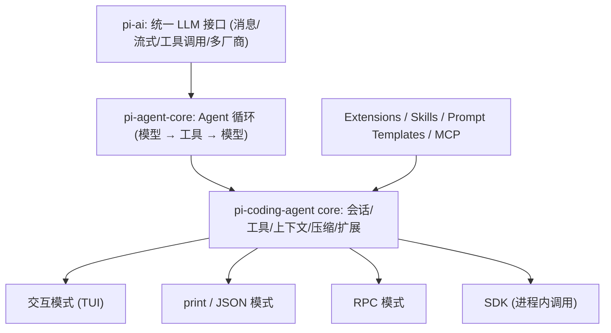
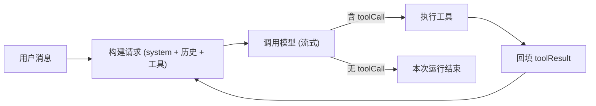

# 基于 pi 项目的 Agent 开发学习计划（10 周）

**适用对象**：10 年 Java 开发，不熟悉 TypeScript，每晚 1–2 小时。
**节奏**：每周 5 个晚上（D1–D5）+ 周末 1 次复盘（可选，1–2 小时）。
**目标**：① 理解 Agent 各组件 ② 能写 pi 插件（extension） ③ 具备独立开发 Agent 的基本能力。

---

## 学习进度打卡

> 每次完成当天的练习和思考题后，将 `[ ]` 改为 `[x]` 并填写日期或简短笔记。

- **第 1 周：TypeScript 速成**
  - [x] W1-D1 环境搭建与源码运行 pi
  - [x] W1-D2 类型系统与标签联合 (`AgentEvent`)
  - [x] W1-D3 泛型、工具类型与类型收窄
  - [x] W1-D4 异步编程与 `AbortSignal`
  - [x] W1-D5 ESM 模块与 TypeBox JSON Schema
  - [x] W1-周末 复盘与小工具重写
- **第 2 周：LLM 基础与 pi-ai**
  - [ ] W2-D1 消息模型与 `complete` 调用
  - [ ] W2-D2 流式输出与思考内容分离打印
  - [ ] W2-D3 工具调用（Function Calling）两轮闭环
  - [ ] W2-D4 协议 vs 厂商（`openai-completions` 与 `reasoning_content`）
  - [ ] W2-D5 测试替身（`faux` provider）
  - [ ] W2-周末 Prompt Cache 与费用对比实验
- **第 3 周：Agent 循环（核心）**
  - [ ] W3-D1 主循环 `runLoop` 流程图与事件
  - [ ] W3-D2 流式响应转换与截断处理
  - [ ] W3-D3 工具串行 vs 并行执行与参数校验
  - [ ] W3-D4 `beforeToolCall` / `afterToolCall` 与 steering 队列
  - [ ] W3-D5 手写 ≤150 行 mini agent
  - [ ] W3-周末 给 mini agent 加轮数限制、错误回传、取消
- **第 4 周：工具设计**
  - [ ] W4-D1 工具三要素与 `read.ts` 分析
  - [ ] W4-D2 `edit` 工具的字符串替换与自修正错误信息
  - [ ] W4-D3 输出截断 (`truncate.ts`)
  - [ ] W4-D4 `bash` 工具进程管理与安全边界
  - [ ] W4-D5 `content` vs `details`（给 mini agent 加 bash 工具）
  - [ ] W4-周末 工具设计 checklist
- **第 5 周：上下文工程**
  - [ ] W5-D1 System Prompt 拼装与 `../AGENTS.md`
  - [ ] W5-D2 Skills 渐进式披露
  - [ ] W5-D3 Prompt Templates
  - [ ] W5-D4 上下文压缩 (`compaction.ts`)
  - [ ] W5-D5 自定义压缩 (`custom-compaction.ts`)
  - [ ] W5-周末 复盘笔记：模型看到的全部内容
- **第 6 周：会话与状态管理**
  - [ ] W6-D1 JSONL 会话文件与树形结构
  - [ ] W6-D2 分支、`/tree` 与 fork
  - [ ] W6-D3 `AgentSession` 调用链时序图
  - [ ] W6-D4 事件总线与订阅
  - [ ] W6-D5 `pi.appendEntry` 扩展状态持久化
  - [ ] W6-周末 给 mini agent 加 JSONL 会话与 `--resume`
- **第 7 周：插件开发 I —— Extension 基础**
  - [ ] W7-D1 最小工具插件 (`java_version`)
  - [ ] W7-D2 自定义命令 (`/mvn-test`)
  - [ ] W7-D3 事件拦截（保护 `pom.xml`）
  - [ ] W7-D4 生命周期事件（统计 token 与耗时）
  - [ ] W7-D5 工具覆盖与动态工具
  - [ ] W7-周末 合并打包“Java 项目助手”插件
- **第 8 周：插件开发 II —— 高级模式**
  - [ ] W8-D1 子 Agent (`subagent`)
  - [ ] W8-D2 计划模式 (`plan-mode`)
  - [ ] W8-D3 结构化输出与 `ask_user`
  - [ ] W8-D4 手动注册 `my-deepseek` Provider
  - [ ] W8-D5 接入 MCP Server
  - [ ] W8-周末 5 种 Agent 架构模式总结
- **第 9 周：SDK / RPC 嵌入 + 测试与评估**
  - [ ] W9-D1 SDK 基础示例 01–05
  - [ ] W9-D2 用 SDK 写 Git diff 代码审查 CLI
  - [ ] W9-D3 用 Java 写 pi RPC 客户端
  - [ ] W9-D4 用 faux provider + harness 写插件单测
  - [ ] W9-D5 设计 10 个 Eval 用例
  - [ ] W9-周末 可观测性方案
- **第 10 周：综合项目 + 转行准备**
  - [ ] W10-D1~D3 毕业项目实现与文档
  - [ ] W10-D4 Spring AI vs pi-ai 横向对比
  - [ ] W10-D5 白板串讲与面试准备

---

## 0. 先建立全局地图

pi 是分层的，学习顺序就按这个分层从下往上走：



| 层 | 目录 | Java 类比 |
|---|---|---|
| LLM 接口 | [packages/ai](file:///d:/WebstormProjects/pi/packages/ai) | 类似 JDBC：一套接口，多家驱动（provider） |
| Agent 循环 | [packages/agent](file:///d:/WebstormProjects/pi/packages/agent) | 类似一个事件驱动的状态机 / 调度器 |
| 编码 Agent | [packages/coding-agent](file:///d:/WebstormProjects/pi/packages/coding-agent) | 类似 Spring Boot 应用：装配所有组件 |
| 扩展机制 | [docs/extensions.md](file:///d:/WebstormProjects/pi/packages/coding-agent/docs/extensions.md) | 类似 SPI / Spring 的 BeanPostProcessor + 事件监听 |

> [!TIP]
> 第一周结束前先通读 [how-pi-works.md](file:///d:/WebstormProjects/pi/packages/coding-agent/docs/how-pi-works.md)（只有约 50 行），它就是整个项目的“目录”。

---

## 0.5 模型环境：DeepSeek

pi 内置了 DeepSeek provider，无需写任何代码：[providers/deepseek.ts](file:///d:/WebstormProjects/pi/packages/ai/src/providers/deepseek.ts)（只有 15 行），走 OpenAI 兼容的 `openai-completions` 协议，`baseUrl` 为 `https://api.deepseek.com`，读取环境变量 `DEEPSEEK_API_KEY`。

**配置步骤（Windows PowerShell）**：

```powershell
# 1. 在 https://platform.deepseek.com 创建 API Key 并充值少量余额

# 2. 方式 A：写入用户环境变量（重开终端生效）
setx DEEPSEEK_API_KEY "sk-xxxx"

# 2. 方式 B：启动 pi 后执行 /login，选择 DeepSeek，Key 保存在 ~/.pi/agent/auth.json（不要提交到 git）

# 3. 从源码启动并指定模型
.\pi-test.ps1 --model deepseek/deepseek-flash
```

**本仓库当前目录中的 DeepSeek 模型**（来自本地生成的模型数据，以 `/model` 实际显示为准）：

| 模型 ID | 名称 | 价格（美元/百万 token，输入/输出/缓存读） | 用途建议 |
|---|---|---|---|
| `deepseek-flash` | DeepSeek V4.1 Flash | 0.3 / 1.2 / 0.006 | **日常练习默认用它**，便宜、支持思考 |
| `deepseek-v4-pro` | DeepSeek V4 Pro | 1.32 / 3.96 / 0.044 | 复杂任务对比效果时用 |

**写代码调用时**（第 2、3 周会用到）：

```typescript
import { builtinModels } from "@earendil-works/pi-ai/providers/all";

const models = builtinModels();
const model = models.getModel("deepseek", "deepseek-flash")!;
// 鉴权自动从 DEEPSEEK_API_KEY 读取
const reply = await models.complete(model, {
	systemPrompt: "You are a helpful assistant.",
	messages: [{ role: "user", content: "用一句话解释什么是 Agent", timestamp: Date.now() }],
});
console.log(reply.content, reply.usage);
```

> [!NOTE]
> DeepSeek 的几个特性正好是很好的学习素材，计划中会专门安排：① OpenAI 兼容协议（理解“协议”和“厂商”是两回事）；② 思考内容通过 `reasoning_content` 字段返回，且多轮时需要回传（`compat.requiresReasoningContentOnAssistantMessages`）；③ 缓存读价格只有输入价的约 2%，非常适合观察 prompt cache 的效果。

> [!TIP]
> 练习阶段默认用 `deepseek-flash`，费用很低，但编码 Agent 每轮都会重发完整上下文，长任务的 token 增长很快。养成每次跑完看 `usage` 的习惯；纯逻辑测试用 faux provider，完全不花钱。

---

## 第 1 周：TypeScript 速成（面向 Java 开发者）

**目标**：能读懂 pi 的代码，不追求精通。

| 天 | 要点 | 练习题 | 思考题 |
|---|---|---|---|
| D1 | 环境：Node 22+、`npm install --ignore-scripts`、`npm run build`、按 [0.5 节](#05-模型环境deepseek) 配置 `DEEPSEEK_API_KEY`，用 `.\pi-test.ps1 --model deepseek/deepseek-flash` 从源码运行 pi | 用 pi 让它解释本仓库 `packages` 目录结构；执行 `/model` 查看可用的 DeepSeek 模型 | `../package.json` 的 `workspaces` 和 Maven 多模块有什么对应关系？ |
| D2 | 类型系统：`interface`/`type`、联合类型、字面量类型、可选属性 `?`、结构化类型（duck typing，和 Java 名义类型的区别） | 读 [agent/src/types.ts](file:///d:/WebstormProjects/pi/packages/agent/src/types.ts)，把 `AgentEvent`（L516 起）手画成一张“事件类型表” | 为什么 TS 用 `type: "xxx"` 字段做**标签联合（tagged union）**，而 Java 常用继承 + `instanceof`？各有什么优劣？（提示：Java 17 sealed interface） |
| D3 | 泛型、`Extract`/`Omit`/`Partial` 等工具类型、`keyof`、类型收窄（`switch (e.type)`） | 解释 `AgentToolCall = Extract<AssistantMessage["content"][number], { type: "toolCall" }>` 每一步在做什么 | TS 的泛型在运行时被擦除，和 Java 泛型擦除有何异同？ |
| D4 | 异步：`Promise`、`async/await`、`AbortSignal`、异步迭代器 `for await` | 写一个 `sleep(ms, signal)`，支持被 `AbortController` 取消 | `AbortSignal` 对应 Java 的什么？（`Future.cancel` / 中断标志）为什么 Agent 里取消如此重要？ |
| D5 | 模块与运行：ESM `import/export`、`npx tsx` 直接跑 `.ts` | 在 scratch 目录写 `hello.ts`，导入 `@earendil-works/pi-ai` 的 `Type` 定义一个 JSON Schema 并打印 | 为什么项目规则禁止 `enum`、参数属性等语法？（看 [AGENTS.md](file:///d:/WebstormProjects/pi/AGENTS.md) 中 “erasable TypeScript syntax”） |
| 周末 | 复盘 | 用 TS 重写一个你熟悉的 Java 小工具（如读取 CSV 统计） | 总结一张 “Java 概念 → TS 写法” 对照表 |

---

## 第 2 周：LLM 基础与 pi-ai（Agent 的“发动机”）

**目标**：理解一次模型调用到底发送了什么、返回了什么。

**阅读**：[ai/README.md](file:///d:/WebstormProjects/pi/packages/ai/README.md)（Quick Start、Tools、Stop Reasons、Thinking 章节）、[ai/src/types.ts](file:///d:/WebstormProjects/pi/packages/ai/src/types.ts)

| 天 | 要点 | 练习题 | 思考题 |
|---|---|---|---|
| D1 | 消息模型：`SystemMessage` / `UserMessage` / `AssistantMessage` / `ToolResultMessage`；内容块 `TextContent`、`ThinkingContent`、`ToolCall` | 用 `deepseek-flash` 调用 `complete`，打印完整的 `AssistantMessage`（含 `usage`、`stopReason`） | 为什么 LLM 是“无状态”的？多轮对话的“记忆”实际存在哪里？ |
| D2 | 流式输出：事件流（`text_delta`、`thinking_delta`、`toolcall_delta` 等），见 README “Complete Event Reference” | 改成 `stream`，开启思考（thinking level `high`），分别用不同颜色打印思考内容和正文，并统计首 token 延迟 | 为什么 Agent 产品几乎都用流式？流式下工具调用参数是“半截 JSON”，怎么处理？ |
| D3 | 工具调用（Function Calling）：用 `Type.Object` 定义工具 schema，模型返回 `toolCall`，你执行后回填 `ToolResultMessage` | 手写一个 `get_weather` 工具，用 DeepSeek 完成“模型请求工具 → 你执行 → 回传结果 → 模型给最终答案”的**两轮**调用 | `stopReason` 为 `toolUse` 和 `stop` 时分别意味着什么？`length` 呢？ |
| D4 | 协议 vs 厂商：[deepseek.ts](file:///d:/WebstormProjects/pi/packages/ai/src/providers/deepseek.ts) 只是“配置”，真正的转换在 [api/openai-completions.ts](file:///d:/WebstormProjects/pi/packages/ai/src/api/openai-completions.ts)；重点看 `thinkingFormat === "deepseek"`（约 L913）和 `reasoning_content` 的解析与回传（约 L578、L1321） | 打开 [debug-provider.ts](file:///d:/WebstormProjects/pi/packages/coding-agent/examples/extensions/debug-provider.ts) 或在请求处打日志，观察发给 DeepSeek 的原始请求体中 `thinking`、`reasoning_effort`、`reasoning_content` 字段 | 为什么 DeepSeek 要求多轮时把上一轮的 `reasoning_content` 回传？统一抽象层用 `compat` 标志处理厂商差异，和 Java 里的“方言”（如 Hibernate Dialect）有什么相似之处？ |
| D5 | 测试替身：[providers/faux.ts](file:///d:/WebstormProjects/pi/packages/ai/src/providers/faux.ts)（假模型，不花钱） | 用 faux provider 写一个返回固定 toolCall 的场景 | 为什么 Agent 开发必须有“假模型”？它和 Java 的 Mockito 有何异同？ |
| 周末 | 复盘：token、上下文窗口、成本、thinking/reasoning | 同一个长 system prompt 连续请求两次 `deepseek-flash`，对比两次 `usage` 中的缓存读 token 和费用 | prompt cache 为什么能省钱？什么操作会让缓存失效？（提示：在 system prompt 开头插入当前时间试试） |

---

## 第 3 周：Agent 循环（最核心的一周）

**目标**：能徒手画出 Agent loop，并能自己实现一个。

**阅读**：[agent-loop.ts](file:///d:/WebstormProjects/pi/packages/agent/src/agent-loop.ts)（959 行，分两晚读完）、[agent.ts](file:///d:/WebstormProjects/pi/packages/agent/src/agent.ts)



| 天 | 要点 | 练习题 | 思考题 |
|---|---|---|---|
| D1 | 主循环 [`runLoop`](file:///d:/WebstormProjects/pi/packages/agent/src/agent-loop.ts#L172-L340)：turn（轮）的概念、何时继续、何时退出 | 画出 `runLoop` 的流程图，标出每个 `emit` 的事件 | 如果模型一直调工具不停止，会怎样？pi 如何防止死循环？你会怎么设计？ |
| D2 | [`streamAssistantResponse`](file:///d:/WebstormProjects/pi/packages/agent/src/agent-loop.ts#L390-L486)：把流式事件转成 Agent 事件 | 在关键处加 `console.log`，用 pi 跑一个任务观察事件顺序 | 模型输出被截断（`length`）时，半截的 toolCall 怎么办？（看 `failToolCallsFromTruncatedMessage`） |
| D3 | 工具执行：[`executeToolCalls`](file:///d:/WebstormProjects/pi/packages/agent/src/agent-loop.ts#L518-L700) 的串行 vs 并行、`prepareToolCall` 参数校验、错误变成 tool result | 对比 `executeToolCallsSequential` 和 `executeToolCallsParallel`，列出差异 | 什么工具可以并行，什么不能？（提示：两个 `edit` 同时改一个文件，看 [file-mutation-queue.ts](file:///d:/WebstormProjects/pi/packages/coding-agent/src/core/tools/file-mutation-queue.ts)） |
| D4 | 钩子：`beforeToolCall` / `afterToolCall`（[types.ts L66–L135](file:///d:/WebstormProjects/pi/packages/agent/src/types.ts#L66-L135)）、steering（中途插话）与 follow-up 队列 | 找到 steering 消息在循环中被插入的位置 | 工具报错时，为什么要把错误**返回给模型**而不是抛异常终止？ |
| D5 | [agent.ts](file:///d:/WebstormProjects/pi/packages/agent/src/agent.ts)：`Agent` 类如何封装状态（`AgentState`）、订阅、取消 | **核心练习**：不依赖 pi-agent-core，只用 pi-ai，写一个 ≤150 行的 mini agent，带 2 个工具（`read_file`、`list_dir`） | 你的 mini agent 和 pi 的实现差在哪？列出至少 5 点（取消、并行、事件、校验、截断……） |
| 周末 | 复盘 | 给 mini agent 加上：最大轮数限制、工具错误回传、Ctrl+C 取消 | 用一句话向非技术人员解释“Agent = LLM + 循环 + 工具” |

---

## 第 4 周：工具设计（Agent 的“手脚”）

**目标**：理解好工具的标准，学会写健壮的工具。

**阅读**：[core/tools/](file:///d:/WebstormProjects/pi/packages/coding-agent/src/core/tools) 下的 `read.ts`、`edit.ts`、`bash.ts`、`truncate.ts`、`grep.ts`

| 天 | 要点 | 练习题 | 思考题 |
|---|---|---|---|
| D1 | 工具三要素：name、description、parameters schema；description 是写给模型看的“API 文档” | 读 `read.ts`，把它的 description 和参数原文抄下来逐句分析意图 | 为什么 pi 只内置很少的工具（read/write/edit/bash 等）而不是几十个？ |
| D2 | `edit` 工具：基于“精确字符串替换”而非行号；diff 生成（`edit-diff.ts`） | 构造 3 种会让 edit 失败的输入（不唯一、不存在、空白差异），观察返回给模型的错误信息 | 为什么用字符串匹配而不用行号？错误信息应该写成什么样模型才能自我修正？ |
| D3 | 输出截断：[truncate.ts](file:///d:/WebstormProjects/pi/packages/coding-agent/src/core/tools/truncate.ts)、[output-accumulator.ts](file:///d:/WebstormProjects/pi/packages/coding-agent/src/core/tools/output-accumulator.ts) | 让 pi 执行一个输出 10 万行的命令，观察截断结果 | 工具输出过长会带来什么问题？（成本、上下文溢出、注意力稀释） |
| D4 | `bash` 工具：进程管理、超时、取消、流式更新 `onUpdate`；Windows 下的 [powershell.ts](file:///d:/WebstormProjects/pi/packages/coding-agent/src/core/tools/powershell.ts) | 读 `bash.ts`，说明 `signal` 被触发时子进程如何被杀掉 | 给 Agent 一个 shell 有哪些安全风险？pi 为什么选择“不内置权限系统”（见 README Permissions 章节）？ |
| D5 | `content`（给模型）vs `details`（给 UI/程序）的区分 | 给第 3 周的 mini agent 加一个带截断的 `bash` 工具 | 什么信息应该给模型、什么只给人看？举例说明 |
| 周末 | 复盘 | 写一份“好工具设计 checklist”（≥8 条） | 如果要让 Agent 操作数据库，你会设计哪几个工具？参数怎么定？ |

---

## 第 5 周：上下文工程（Context Engineering）

**目标**：理解“模型看到了什么”决定了 Agent 的上限。

**阅读**：[system-prompt.ts](file:///d:/WebstormProjects/pi/packages/coding-agent/src/core/system-prompt.ts)、[skills.ts](file:///d:/WebstormProjects/pi/packages/coding-agent/src/core/skills.ts) + [docs/skills.md](file:///d:/WebstormProjects/pi/packages/coding-agent/docs/skills.md)、[prompt-templates.ts](file:///d:/WebstormProjects/pi/packages/coding-agent/src/core/prompt-templates.ts)、[compaction/](file:///d:/WebstormProjects/pi/packages/coding-agent/src/core/compaction) + [docs/compaction.md](file:///d:/WebstormProjects/pi/packages/coding-agent/docs/compaction.md)

| 天 | 要点 | 练习题 | 思考题 |
|---|---|---|---|
| D1 | 系统提示词如何拼装：基础指令 + 工具说明 + 上下文文件（`../AGENTS.md`）+ skill 列表 | 用扩展里的 `ctx.getSystemPrompt()` 或 [system-prompt-header.ts](file:///d:/WebstormProjects/pi/packages/coding-agent/examples/extensions/system-prompt-header.ts) 打印出完整 system prompt | 本仓库的 `../AGENTS.md` 为什么能约束 pi 的行为？它和“微调”有什么本质区别？ |
| D2 | Skills：**渐进式披露**——只把描述放进上下文，需要时才读全文 | 写一个 skill（如“生成 Java 单元测试规范”），让 pi 在合适时机自动加载 | 为什么不把所有 skill 全文都塞进 system prompt？ |
| D3 | Prompt Templates：输入展开 | 写一个 `/review` 模板，展开为固定的代码审查指令 | 模板、skill、system prompt 三者的边界是什么？ |
| D4 | 上下文压缩：[compaction.ts](file:///d:/WebstormProjects/pi/packages/coding-agent/src/core/compaction/compaction.ts) 何时触发、如何生成摘要、保留哪些消息 | 跑一个长任务，触发 `/compact`，对比压缩前后的消息 | 压缩一定会丢信息，哪些信息最不该丢？（文件路径、用户约束、未完成事项……） |
| D5 | 自定义压缩：[custom-compaction.ts](file:///d:/WebstormProjects/pi/packages/coding-agent/examples/extensions/custom-compaction.ts) | 修改示例，让摘要强制包含“待办列表”段落 | 除了摘要，还有哪些控制上下文的手段？（截断、子 agent、外部记忆、检索） |
| 周末 | 复盘 | 写一篇 500 字笔记：“一次请求中模型看到的全部内容” | Prompt Engineering 和 Context Engineering 的区别是什么？ |

---

## 第 6 周：会话与状态管理

**目标**：理解 Agent 的持久化、分支、恢复。

**阅读**：[docs/session-format.md](file:///d:/WebstormProjects/pi/packages/coding-agent/docs/session-format.md)、[docs/sessions.md](file:///d:/WebstormProjects/pi/packages/coding-agent/docs/sessions.md)、[session-manager.ts](file:///d:/WebstormProjects/pi/packages/coding-agent/src/core/session-manager.ts)、[agent-session.ts](file:///d:/WebstormProjects/pi/packages/coding-agent/src/core/agent-session.ts)（4000+ 行，**只读主干**：构造、`prompt`、事件转发）

| 天 | 要点 | 练习题 | 思考题 |
|---|---|---|---|
| D1 | JSONL 会话文件 + 树形结构（每条 entry 有 id 和 parentId） | 打开 `~/.pi/agent/sessions` 下一个真实会话文件，手画它的树 | 为什么用 append-only 的 JSONL 而不是数据库？和事件溯源（Event Sourcing）有什么关系？ |
| D2 | 分支：`/tree`、fork、从历史节点继续 | 在 pi 中制造一个分支，再观察文件变化 | “活动分支”如何决定下一次请求的历史？ |
| D3 | `AgentSession`：把 Agent、会话存储、扩展、模型注册表组装在一起 | 找出用户输入从 `prompt()` 到 `agent-loop` 的调用链，写成时序图 | 这个类 4000 多行，如果你来重构，会按什么职责拆？ |
| D4 | 事件总线：[event-bus.ts](file:///d:/WebstormProjects/pi/packages/coding-agent/src/core/event-bus.ts)、`subscribe` | 用 SDK 订阅所有事件并按类型计数 | 观察者模式在这里解决了什么耦合问题？ |
| D5 | 自定义消息/entry：`pi.appendEntry` 持久化扩展状态（见 extensions.md “State Management”） | 读 [todo.ts](file:///d:/WebstormProjects/pi/packages/coding-agent/examples/extensions/todo.ts)，弄清它如何在会话切换/分支后恢复状态 | 扩展状态存在内存变量里会有什么 bug？ |
| 周末 | 复盘 | 给 mini agent 加上 JSONL 会话保存和 `--resume` | Agent 的“短期记忆”和“长期记忆”分别对应 pi 里的什么？pi 没做的长期记忆你会怎么设计？ |

---

## 第 7 周：插件开发 I —— Extension 基础

**目标**：能独立写工具型、命令型、拦截型插件。

**阅读**：[docs/extensions.md](file:///d:/WebstormProjects/pi/packages/coding-agent/docs/extensions.md)（3000+ 行，按目录跳读：Quick Start、Writing an Extension、Events、ExtensionContext、Custom Tools）、[examples/extensions/README.md](file:///d:/WebstormProjects/pi/packages/coding-agent/examples/extensions/README.md)

运行方式：`pi -e ./my-extension.ts`

| 天 | 要点 | 练习题 | 思考题 |
|---|---|---|---|
| D1 | 最小插件：[hello.ts](file:///d:/WebstormProjects/pi/packages/coding-agent/examples/extensions/hello.ts)、`defineTool`、`pi.registerTool` | 写 `java_version` 工具：执行 `java -version` 并返回结果 | 插件默认导出一个工厂函数 `(pi) => {}`，和 Java SPI 的 `ServiceLoader` 有什么异同？ |
| D2 | 命令：`pi.registerCommand`，参考 [commands.ts](file:///d:/WebstormProjects/pi/packages/coding-agent/examples/extensions/commands.ts) | 写 `/mvn-test` 命令：运行 `mvn test` 并把失败摘要作为用户消息发给模型（`pi.sendUserMessage`） | 命令（人触发）和工具（模型触发）应该如何分工？ |
| D3 | 事件拦截：`tool_call` 事件 + `{ block: true }`；参考 [permission-gate.ts](file:///d:/WebstormProjects/pi/packages/coding-agent/examples/extensions/permission-gate.ts)、[protected-paths.ts](file:///d:/WebstormProjects/pi/packages/coding-agent/examples/extensions/protected-paths.ts) | 写插件：禁止修改 `pom.xml` 和 `src/main/resources/application*.yml`，被拦截时告诉模型原因 | 拦截后返回给模型的 reason 写得好坏，对后续行为有什么影响？ |
| D4 | 生命周期事件：`session_start`、`agent_end`、`turn_end` 等；参考 [auto-commit-on-exit.ts](file:///d:/WebstormProjects/pi/packages/coding-agent/examples/extensions/auto-commit-on-exit.ts)、[notify.ts](file:///d:/WebstormProjects/pi/packages/coding-agent/examples/extensions/notify.ts) | 写插件：每次 agent 结束时统计本次 token 用量和耗时，用 `ctx.ui.notify` 显示 | 多个插件监听同一事件时执行顺序如何？（extensions.md “Handler Composition”） |
| D5 | 工具覆盖与动态工具：[tool-override.ts](file:///d:/WebstormProjects/pi/packages/coding-agent/examples/extensions/tool-override.ts)、[dynamic-tools.ts](file:///d:/WebstormProjects/pi/packages/coding-agent/examples/extensions/dynamic-tools.ts)、`pi.setActiveTools` | 写插件：给内置 `read` 加一层，读取 `.java` 文件时自动附带类结构摘要 | 工具集合在会话中途变化，对 prompt cache 有什么影响？ |
| 周末 | **小作品**：把本周插件合并成一个“Java 项目助手”插件 | 打包为 Pi package（[docs/packages.md](file:///d:/WebstormProjects/pi/packages/coding-agent/docs/packages.md)） | 插件运行在 pi 进程内拥有完整权限，作为插件作者和使用者分别要注意什么？ |

---

## 第 8 周：插件开发 II —— 高级模式

**目标**：掌握多 Agent、计划模式、自定义模型、结构化输出等常见 Agent 模式。

| 天 | 要点 | 练习题 | 思考题 |
|---|---|---|---|
| D1 | 子 Agent：[subagent/](file:///d:/WebstormProjects/pi/packages/coding-agent/examples/extensions/subagent) | 读懂后新增一个 “reviewer” 子 agent，只有只读工具 | 子 agent 解决的核心问题是什么？（上下文隔离）它的代价是什么？ |
| D2 | 计划模式：[plan-mode/](file:///d:/WebstormProjects/pi/packages/coding-agent/examples/extensions/plan-mode) | 修改为：计划阶段禁用写工具，用户确认后再启用 | pi 为什么不内置 plan mode 和 subagent，而是做成示例插件？ |
| D3 | 结构化输出与交互：[structured-output.ts](file:///d:/WebstormProjects/pi/packages/coding-agent/examples/extensions/structured-output.ts)、[question.ts](file:///d:/WebstormProjects/pi/packages/coding-agent/examples/extensions/question.ts) | 写一个 `ask_user` 工具，让模型在不确定时向用户提选择题 | 让模型输出结构化 JSON 有哪些方式？（工具调用、JSON mode、约束采样） |
| D4 | 自定义 Provider：[docs/custom-provider.md](file:///d:/WebstormProjects/pi/packages/coding-agent/docs/custom-provider.md)、[custom-provider-anthropic/](file:///d:/WebstormProjects/pi/packages/coding-agent/examples/extensions/custom-provider-anthropic) | 假装 pi 没有内置 DeepSeek：用 `pi.registerProvider` 注册一个名为 `my-deepseek` 的 provider（OpenAI 兼容、`https://api.deepseek.com`），跑通后与内置 [deepseek.ts](file:///d:/WebstormProjects/pi/packages/ai/src/providers/deepseek.ts) 对比；故意不设 `thinkingFormat: "deepseek"`，观察思考模式下多轮对话会出什么问题 | 接入一个新模型需要处理哪些差异？（消息格式、工具格式、思考内容、usage）公司内部部署的私有模型网关该怎么接？ |
| D5 | MCP：[docs/mcp.md](file:///d:/WebstormProjects/pi/packages/coding-agent/docs/mcp.md)、[packages/mcp](file:///d:/WebstormProjects/pi/packages/mcp) | 接入一个现成的 MCP server，观察它的工具如何出现在 pi 中 | MCP 和 pi extension 的工具有什么区别？什么时候选哪个？ |
| 周末 | 复盘 | 用 [handoff.ts](file:///d:/WebstormProjects/pi/packages/coding-agent/examples/extensions/handoff.ts) 或 [summarize.ts](file:///d:/WebstormProjects/pi/packages/coding-agent/examples/extensions/summarize.ts) 做一个改造 | 总结 5 种常见 Agent 架构模式（ReAct、Plan-and-Execute、多 Agent、Router、Reflection）在 pi 中各对应哪些代码 |

---

## 第 9 周：把 Agent 嵌入应用（SDK / RPC）+ 测试与评估

**目标**：从“使用 Agent”到“用 Agent 构建产品”。

| 天 | 要点 | 练习题 | 思考题 |
|---|---|---|---|
| D1 | SDK：[docs/sdk.md](file:///d:/WebstormProjects/pi/packages/coding-agent/docs/sdk.md)、[examples/sdk/01-minimal.ts](file:///d:/WebstormProjects/pi/packages/coding-agent/examples/sdk/01-minimal.ts) 到 `05-tools.ts` | 依次跑通 01–05 | `createAgentSession` 帮你装配了哪些组件？ |
| D2 | SDK 进阶：`11-sessions.ts`、`12-full-control.ts` | 用 SDK 写一个 CLI：输入 Git diff，输出代码审查报告（不加载任何默认扩展） | 什么场景该用 SDK，什么场景该写 extension？ |
| D3 | RPC：[docs/rpc.md](file:///d:/WebstormProjects/pi/packages/coding-agent/docs/rpc.md)、[rpc-client.ts](file:///d:/WebstormProjects/pi/packages/coding-agent/examples/rpc-client.ts) | **用 Java 写一个 RPC 客户端**：启动 `pi --mode rpc` 子进程，通过 stdin/stdout 的 JSONL 发送 prompt 并接收事件 | 这就是你把 Java 后端和 TS Agent 结合的桥梁。它和 HTTP API 方式比有什么优缺点？ |
| D4 | 测试：faux provider + [test/suite/harness.ts](file:///d:/WebstormProjects/pi/packages/coding-agent/test/suite/harness.ts)，读 `test/suite/` 下 1–2 个测试 | 给第 7 周的“禁止修改 pom.xml”插件写一个测试 | 不确定性输出的 Agent，单元测试应该测什么、不测什么？ |
| D5 | 评估（evals）：[packages/evals](file:///d:/WebstormProjects/pi/packages/evals) | 设计 10 个用例评估你的“Java 项目助手”（成功率、轮数、token） | 单测和 eval 的区别是什么？eval 结果怎么指导你改 prompt/工具？ |
| 周末 | 复盘 | 写一份可观测性方案：需要记录哪些指标和日志（参考 [packages/telemetry](file:///d:/WebstormProjects/pi/packages/telemetry)） | 线上 Agent 出现“乱改代码”，你如何定位是模型、提示词、工具还是上下文的问题？ |

---

## 第 10 周：综合项目 + 转行准备

**目标**：产出能写进简历的作品，建立横向视野。

| 天 | 要点 | 练习题 | 思考题 |
|---|---|---|---|
| D1–D3 | **毕业项目**（三选一）：① 发布一个 Pi package（含工具 + 命令 + 拦截 + skill + 测试）；② 用 pi-ai 从零写一个 500 行内的完整编码 agent（流式、并行工具、会话、压缩、取消）；③ Java 后端 + pi RPC 的“企业内部代码助手”原型 | 写 README：架构图、设计取舍、已知限制 | 你的项目和 pi 相比，故意省略了什么？为什么？ |
| D4 | 横向对比：LangChain/LangGraph、OpenAI Agents SDK、Claude Agent SDK、Spring AI（Java 生态） | 用 Spring AI 接 DeepSeek（它同样是 OpenAI 兼容接口）实现第 2 周 D3 的天气工具，对比 pi-ai 的写法 | 这些框架的抽象层分别对应 pi 的哪一层？ |
| D5 | 面试准备 | 能在白板上 10 分钟讲清：Agent loop、工具设计、上下文管理、会话持久化、安全 | 你的 10 年 Java 经验在 Agent 岗位上的优势是什么？（工程化、并发、可观测、稳定性、企业集成） |

---

## 附录 A：Java → TypeScript 速查

| Java | TypeScript |
|---|---|
| `interface Foo { String name(); }` | `interface Foo { name: string }` |
| `sealed interface Event permits A, B` | `type Event = { type: "a" } \| { type: "b" }` |
| `Optional<String>` | `string \| undefined` 或 `name?: string` |
| `CompletableFuture<T>` | `Promise<T>` |
| `Thread.interrupt()` / `Future.cancel()` | `AbortController.abort()` + `AbortSignal` |
| `Map<String, Object>` | `Record<string, unknown>` |
| Jackson + Bean Validation | TypeBox `Type.Object(...)`（同时是类型和 JSON Schema） |
| Maven 多模块 | npm workspaces |
| JUnit + Mockito | Vitest + faux provider |

## 附录 B：学习方法建议

1. **先跑起来再读代码**：每个模块先用 pi 实际体验功能，再读实现。
2. **让 pi 当你的导师**：在本仓库里启动 pi，直接问“`runLoop` 中 steering 消息是在哪一步插入的？”——这本身就是在练习使用 Agent。
3. **大文件只读主干**：`agent-session.ts`、`extensions.md` 这类超长文件，按目录/函数签名跳读，不要逐行读。
4. **每周产出一个可运行的东西**：mini agent 从第 3 周开始持续迭代，到第 10 周就是你的作品。
5. **费用控制**：练习默认用 `deepseek-flash`，需要对比效果时再切 `deepseek-v4-pro`；逻辑测试用 faux provider；第 2 周学会看 `usage` 后养成习惯。
