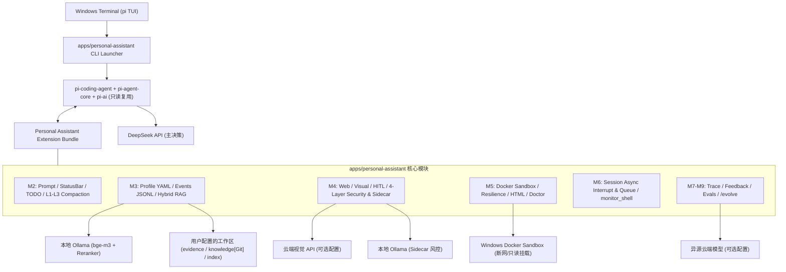

# 个人智能体助理分章节开发计划（M1–M10）

## 概述与架构基线

基于已定稿的 [personal-assistant-spec.md](./personal-assistant-spec.md)，将《AI Agents in Depth》第 1 至 10 章的需求拆解为可按里程碑独立实现、独立验收的开发计划。

经对当前 `pi` 仓库的调研，核心复用基线如下：
- **主模型协议**：[`openai-completions.ts`](../packages/ai/src/api/openai-completions.ts) 与 [`deepseek.ts`](../packages/ai/src/providers/deepseek.ts) 已原生支持 DeepSeek `thinkingFormat: "deepseek"` 与 `reasoning_content` 回传。
- **扩展钩子面**：[`packages/coding-agent/src/core/extensions/types.ts`](../packages/coding-agent/src/core/extensions/types.ts) 已暴露 `before_agent_start`、`context`、`session_before_compact`、`tool_call`、`tool_result`、`turn_end`、`agent_end`、`session_shutdown`、`pi.registerTool`（可覆盖内置工具）、`pi.registerCommand`、`ctx.ui.setWidget` 与 `ctx.ui.select`。
- **评估与运行底座**：[`packages/evals`](../packages/evals) 已有 Docker 隔离评估骨架；仓库要求 Node.js `>=22.19.0`，可直接使用内置 `node:sqlite` 与 `Intl.Segmenter`。

因此采用 **“独立 Workspace 应用 + `pi` 扩展包”** 形态：新增 `apps/personal-assistant/`（纳入根目录 [`package.json`](../package.json) 的 `apps/*` workspace），**严禁修改 `pi` 自身源代码（`packages/*` 全程零改动，纯通过公开 SDK 与 `ExtensionAPI` 复用）**。



---

## 已确认约束

> [!IMPORTANT]
> 1. **零侵入硬约束**：全部代码放在 `apps/personal-assistant/`，**严禁修改 `pi` 仓库原有源代码（`packages/*`）**；所有拦截、状态栏、压缩保真、沙箱路由、自定义工具与命令均通过 `pi` 的 `ExtensionAPI` 与 SDK 实现。
> 2. **Windows 零原生编译选型**：本地索引采用 Node 22 内置 `node:sqlite`（FTS5 + float32 BLOB 向量）与内置 `Intl.Segmenter("zh-CN", { granularity: "word" })` 中文分词；PDF 解析走 Docker 镜像内 Python `pymupdf`。
> 3. **外部供应商配置先留空**：云端视觉 API（`analyze_visual`）、异源 Judge（`LLM-as-a-Judge`）与联网搜索后端（`web_search`）均设计为可插拔配置项，默认留空；未配置时工具返回明确配置提示并由 `/doctor` 标出，不硬编码特定厂商。
> 4. **工作区路径由用户配置**：`workspaceDir`（及可选外部 `notesDir` / `rawPdfsDir`）全部由用户在 `assistant.config.json` 或环境变量显式配置，不做硬编码路径假设。

---

## 分章节开发计划（M1–M10）

以下 **M1–M9 为一期开发里程碑**（M8 仅含数据契约校验），**M10 为二期演进里程碑**。每个里程碑均可独立开发、独立测试、独立验收。

---

### Milestone 1（第 1 章）：应用骨架、工作区初始化、任务状态机与 DeepSeek 接入

**目标**：跑通最小可运行的 `pi-assistant` CLI，建立 `TaskRun` 统一状态机与可消融特性开关、三层目录骨架，并用 DeepSeek 在 `pi` TUI 中完成多会话隔离对话。

#### `[NEW]` `apps/personal-assistant/package.json` & `tsconfig.json` & `vitest.config.ts`
- 定义独立 workspace 包 `@earendil-works/pi-personal-assistant`，依赖本地 workspace 的 `@earendil-works/pi-coding-agent`、`@earendil-works/pi-agent-core`、`@earendil-works/pi-ai`、`@earendil-works/pi-tui`（严格 pinned 版本，遵守根目录 `AGENTS.md` 的 erasable TypeScript 语法规范）。

#### `[NEW]` `apps/personal-assistant/src/config.ts`
- 定义配置加载与校验（`assistant.config.json` + 环境变量）：
  - 工作区路径（`workspaceDir`、`notesDir`、`rawPdfsDir`，均由用户配置）
  - 模型配置（DeepSeek 主模型、可选云端视觉 API、可选异源 Judge、可选联网搜索后端、Ollama endpoint 与模型名）
  - 预算与留存配置（最大轮次/时长/工具调用数/费用提醒、临时文件留存天数、视觉媒体大小与页数上限）
  - **可消融特性开关（预埋第 7 章要求）**：
    ```ts
    export interface FeatureFlags {
      statusBar: boolean;
      l2MicroCompact: boolean;
      reranker: boolean;
      sidecar: boolean;
      dockerSandbox: boolean;
    }
    ```

#### `[NEW]` `apps/personal-assistant/src/workspace.ts`
- 幂等初始化三层目录骨架：
  - `evidence/{sessions,raw_pdfs,artifacts,traces,feedback}`
  - `knowledge/{memory/profile,memory/events,experience,notes}`（自动初始化 Git 仓库与 `.gitignore`，确保 `index/` 排除在 Git 外）
  - `index/`

#### `[NEW]` `apps/personal-assistant/src/runtime/task-run.ts`
- 实现 `TaskRun` 实体与统一状态机（`MOD-007`、`PLN-006`）：
  - 字段：`runId`、`sessionId`、`goal`、`status`、`startedAt`、`endedAt`、`terminationReason`、`planVersion`、`budgetUsage`；
  - 强制合法状态转换：`queued -> planning -> running -> waiting_for_approval / waiting_for_input -> completed / partially_completed / failed / cancelled / budget_exceeded`；
  - 禁止非法跳转，且当存在未完成关键步骤或未满足交付条件时拒绝流转为 `completed`，仅允许收敛至 `partially_completed` / `failed`。

#### `[NEW]` `apps/personal-assistant/src/extension.ts` & `src/cli.ts`
- `extension.ts`：聚合后续各章子模块（按里程碑逐步挂入 `ExtensionAPI`）。
- `cli.ts`：启动 `pi` 交互式 TUI，加载 `extension.ts`、内置 `skills/`、默认选定 DeepSeek 模型，并支持独立子命令（后续挂入 `doctor`、`eval`）。

**M1 验收标准**：执行启动命令进入 `pi` TUI，工作区三层目录与 `knowledge/` Git 仓库自动创建；每次运行生成唯一 `runId` 且 `TaskRun` 状态流转合法、未完成任务不会标记为 `completed`；与 DeepSeek 正常完成多轮工具调用对话，且开启思考模式时 `reasoning_content` 正常回传无 400 错误。

---

### Milestone 2（第 2 章）：上下文工程、状态栏、会话管理、首批 Skills 与三层保真压缩

**目标**：建立 KV Cache 友好的静态前缀、确定性 `<agent_status>` 状态栏、TUI 实时 TODO 面板、会话生命周期命令、两项首批 Skills，以及不依赖纯提示词的三层对话压缩保真机制。

#### `[NEW]` `apps/personal-assistant/src/context/system-prompt.ts`
- 监听 `before_agent_start`：设置个人助理角色 `customPrompt`、精简输出风格、意图澄清规则、**事实/推断/未验证假设区分规范（`KNO-005`）**与忠诚度守则，并将已确认的 `<user_profile>` 静态注入 `sections.user_profile`（会话内保持字节级不变）。
- 注册 `/snapshot-prompt` 命令：导出当前完整渲染后的静态前缀快照（供第 7 章版本对比）。

#### `[NEW]` `apps/personal-assistant/src/commands/session.ts`
- 注册 `/session search|rename|archive|export|delete` 命令（`MEM-002`）：支持按关键词搜索历史会话、重命名、归档、导出为 Markdown/JSON 及按策略安全删除会话记录（明确提示影响范围且绝不删除 `knowledge/`）。

#### `[NEW]` `apps/personal-assistant/src/context/todo.ts`
- 注册专用工具 `todo`（支持 `rewrite` / `update_status`，字段含 `id / title / status / updatedAt`）。
- 每次变更通过 `ctx.ui.setWidget("assistant-todos", ...)` 实时渲染到 `pi` 终端 TUI，同时持久化到会话状态文件供压缩外置恢复。

#### `[NEW]` `apps/personal-assistant/src/context/status-bar.ts`
- 监听 `tool_result` 维护确定性计数器（各工具累计调用次数、连续失败次数与最近错误摘要）。
- 监听 `context`（每次 LLM 请求前）：当 `flags.statusBar` 开启时，在消息列表末尾追加单条 `<agent_status>` 用户角色消息（当前本地时间、距上次交互间隔、当前 `runId` 与 `TaskRun` 状态、活跃目录/Git 概览、工具计数与连续失败告警、当前 TODO 清单），不污染静态前缀。

#### `[NEW]` `apps/personal-assistant/src/context/token-estimator.ts`
- 实现中英文混合 token 估算器（CJK 字符按 ~1.2 token/字、ASCII 按 ~0.25 token/字符加权），替代纯英文 `chars / 4` 估算。

#### `[NEW]` `apps/personal-assistant/src/context/compaction.ts`
- **L1 写时落盘 + 冻结预览**：在 `tool_result` 中检测超大输出（> 8KB 或 > 200 行），完整内容落盘至 `evidence/artifacts/<session>/<toolCallId>.txt`，将上下文内容替换为冻结的“头尾预览 + 行数/字节 + 路径指针”。
- **L2 批量清理过期噪声**：在 `context` / `turn_end` 检测达 60%–65% 窗口阈值且 `flags.l2MicroCompact` 开启时，通过 `context_edit` 批量将早于最近 N 轮的只读大工具输出折叠为单行 artifact 指针（零 LLM 调用）。
- **L3 任务感知结构化摘要 + 保真四件套**：监听 `session_before_compact`（70%–75% 触发）：
  1. 代码确定性提取 `SourceIndex`（`readFiles`、`modifiedFiles`、`urls`、`pdfPages`、`artifacts`、`failedCommands`）；
  2. 注册 `/pin` 命令标记不可压缩锚点消息，切分时强制原文保留；
  3. 注入活跃 TODO 与外置硬约束到压缩提示词，要求输出结构化槽位（含 `Failed Attempts` 段），压缩完成后由代码强制挂载 `SourceIndex` 与外置状态；
  4. **熔断器**：维护连续压缩失败计数，连续失败 2 次即熔断降级并提示用户；
  5. 注册只读工具 `search_session_history(query, limit?)` 检索当前会话原始 JSONL 轨迹。

#### `[NEW]` `apps/personal-assistant/skills/note-organization/SKILL.md`
- 个人 Markdown 笔记整理 SOP（YAML frontmatter 规范、双链 `[[...]]` 维护、PDF 页码出处标注规则、事实/推断/待核验事项区分规范、目录 `_index.md` 同步更新）。

#### `[NEW]` `apps/personal-assistant/skills/local-data-processing/SKILL.md`
- 本地数据处理 SOP（强制沙箱 Python 脚本执行、禁止心算手抄、CSV UTF-8-BOM 与金额精度校验、单文件交互式 HTML 报告产出规范）。

**M2 验收标准**：
- 长会话测试中静态前缀哈希 100% 不变，`<agent_status>` 仅出现在末尾；
- TUI 实时显示 TODO 进度；`/session` 搜索、重命名、归档、导出与删除行为可验证；
- 超大工具输出自动落盘并冻结预览；
- 模拟中文长上下文触发 L2 -> L3 压缩后，`pinned` 消息原文、`SourceIndex` 路径/URL 与硬约束零丢失，且 `search_session_history` 可回查归档细节。

---

### Milestone 3（第 3 章）：双层记忆系统与本地 Ollama 混合 RAG

**目标**：落地三层分离持久化记忆（Layer 1 YAML Profile + Layer 2 只增 JSONL Events）、用户记忆控制与敏感凭证守卫，并为 1000+ Markdown/PDF 建成基于本地 Ollama 的结构感知切分与混合检索流水线。

#### `[NEW]` `apps/personal-assistant/src/memory/secret-guard.ts`
- 实现确定性敏感凭证检测与脱敏器（`MEM-007`、`SEC-008`）：识别常见 API Key、Bearer Token、私钥块、连接串密码等模式；供 `profile-store.ts`、`event-store.ts`、M5 `html-report.ts` 与 M7 `trace-store.ts` 复用，阻止明文凭证落入记忆、普通日志与交付产物。

#### `[NEW]` `apps/personal-assistant/src/memory/profile-store.ts` & `src/memory/event-store.ts` & `src/commands/memory.ts`
- `profile-store.ts`：读写 `knowledge/memory/profile/*.yaml`（严格校验 `id / category / key / value / scope / status / confidence / backstory / evidence_refs / created_at / updated_at`），写入前过 `secret-guard.ts`；提供编译 `<user_profile>` 块方法（截断在 1–2K token 预算内）与写入工作分支/提案方法（分级更新：改核心偏好需人工确认）。
- `event-store.ts`：管理 `knowledge/memory/events/YYYY-MM.jsonl`（只增不改 ADD-only，支持 `supersedes` 链解析与过期标注）；监听 `session_shutdown`（仅在会话正常结束且非异常崩溃、且记忆开关开启时）：提取本会话结构化事件记录，过 `secret-guard.ts` 后自动追加并写入索引队列。
- `commands/memory.ts`（`MEM-005`）：注册 `/memory list|show|edit|delete|off|on` 命令，支持用户直接查看、编辑、删除记忆条目，以及全局/会话级关闭记忆（关闭后不注入也不写入新记忆）。

#### `[NEW]` `apps/personal-assistant/src/rag/parser.ts` & `scripts/parse_pdf.py`
- Markdown 解析：提取 YAML frontmatter、`H1–H3` 标题面包屑与双链。
- PDF 解析：调用 Python `pymupdf` 脚本按页提取文本与表格，过滤跨页重复页眉页脚，记录精确 `page_range: [start, end]`；检测低文本密度扫描页并打 `needs_visual_ocr` 标记。

#### `[NEW]` `apps/personal-assistant/src/rag/chunker.ts`
- 实现结构感知递归切分：
  - 按 `H1 -> H2 -> H3 -> 段落 -> 句子` 切分；
  - 保护代码块、表格、公式原子块不被拦腰切断（原子块上限 1200 tokens）；
  - 目标 350–600 tokens、常规上限 800 tokens、同章节 15% 重叠、< 80 字短块合并；
  - 全量强制拼接 L1 确定性上下文前缀 `[文档 | 路径 | 章节 | 页码 | 标签 | 更新日期]`，支持按配置对无结构长 PDF 开启 L2 本地 Ollama 语义前缀。

#### `[NEW]` `apps/personal-assistant/src/rag/ollama-client.ts`
- 封装本地 Ollama HTTP API：`embed(texts, model="bge-m3")`、`rerank(query, docs)`（兼容 Ollama / 本地轻量 reranker 端点）与健康检查。

#### `[NEW]` `apps/personal-assistant/src/rag/index-store.ts`
- 基于 Node 22 `node:sqlite` 管理 `index/fts.sqlite`（FTS5 存 `Intl.Segmenter` 中文预分词文本）与 `index/vectors.db`（存 chunk 元数据与 float32 向量 BLOB），配合 `index/manifest.json` 的 `sha256` 实现单文件秒级增量更新与一键全量重建。

#### `[NEW]` `apps/personal-assistant/src/rag/retriever.ts` & `src/rag/tools.ts`
- 实现完整混合检索流水线：元数据预过滤 -> BM25 Top-30 + 向量 Top-30 -> RRF 融合（`k=60`，默认 `0.5/0.5`，精确路径/代码/引号查询动态倾斜 `0.7/0.3`）取 Top-25 -> 若 `flags.reranker` 开启则精排取 Top-6~8 -> 合并同文档相邻命中块并附精确出处与 `supersedes` 状态。
- 注册 3 个 Agentic RAG 工具：`search_knowledge`、`search_memory`、`browse_knowledge_index`，以及手动建索引命令 `/reindex`。

**M3 验收标准**：
- 模拟写入 200+ Markdown 与多份含表格/页码 PDF，增量重建索引无报错；
- 精确术语、同义词语义、跨页 PDF 片段、带 `supersedes` 冲突的多会话事件均能准确召回并附精确文件路径与页码；
- `/memory off` 后不注入也不追加新记忆；尝试写入含明文 API Key 的记忆条目被 `secret-guard.ts` 拦截；
- 删空 `index/` 后一键 `/reindex` 可完整重建。

---

### Milestone 4（第 4 章）：工具治理、云端视觉感知、MCP 代理与四层执行安全

**目标**：补齐工具元数据/停用治理与外部信息/视觉工具，落地按需发现与权限可撤销的 MCP 代理策略，以及包含参数绑定审批、副作用幂等保护与 fail-closed 本地 Ollama Sidecar 在内的四层执行安全与可回滚机制。

#### `[NEW]` `apps/personal-assistant/src/tools/registry-governance.ts`
- 实现工具注册元数据校验与运行期治理（`TLS-001`、`TLS-007`）：
  - 校验工具名称、用途、参数 schema、权限范围、风险等级（`readonly | reversible_write | high_impact`）与版本，缺必填元数据拒绝启用；
  - 维护各工具健康状态与停用清单，注册 `/tools list|health|disable|enable` 命令（停用后不再向模型暴露）。

#### `[NEW]` `apps/personal-assistant/src/tools/web.ts`
- 注册 `web_search` 与 `fetch_url`；抓取正文转 Markdown，超长结果走 M2 L1 落盘，返回内容统一包裹 `<external_content source="url">` 防提示注入混淆；未配置搜索后端时返回清晰配置引导。

#### `[NEW]` `apps/personal-assistant/src/tools/visual.ts`
- 注册 `analyze_visual(file_path, question, page?)`：支持本地图片或将指定 PDF 页渲染为图片，调用用户配置的**云端视觉 API** 回答针对性问题，仅返回精炼文本结论与页码出处；校验**媒体输入上限（`MM-004`）**（允许格式、单文件体积、单次最大页数，超限直接拒绝并说明限制）；未配置视觉 API 时返回明确提示。

#### `[NEW]` `apps/personal-assistant/src/tools/hitl.ts`
- 注册 `request_human_approval` 与 `request_human_input`，调用 `ctx.ui.select` / `ctx.ui.input` 暂停等待用户决策；
- **审批动作参数绑定与审计（`SEC-004`、`SEC-009`）**：生成包含 `{ approvalId, runId, policyVersion, tool, canonicalArgsHash, targetScope, decision, reason, decidedAt }` 的审批票据并持久化；执行前校验票据哈希，目标或参数有任何变更即失效重审。

#### `[NEW]` `apps/personal-assistant/src/tools/mcp-proxy.ts`
- 实现 MCP 延迟启动与按需发现代理（默认仅暴露轻量 `mcp_discover` / `mcp_call` 索引工具，按需拉取目标工具 schema 追加至轨迹末尾，并检查锁定版本清单与描述审查标记）；
- 实现连接器权限查看与撤销（`SEC-012`）：注册 `/mcp permissions` 与 `/mcp revoke <server>` 命令，撤销后新调用立即拒绝并记录审计。

#### `[NEW]` `apps/personal-assistant/src/security/path-guard.ts`
- **层 1（输入校验与目录边界）**：在 `tool_call` 中拦截所有文件/路径类工具，规范化路径防止 `../` 逃逸，强区分只读区（`evidence/raw_pdfs/`、`evidence/sessions/`）、受控读写区（`knowledge/`、任务工作区）与未授权区。

#### `[NEW]` `apps/personal-assistant/src/security/rollback-guard.ts`
- **层 2（写前快照 + 写后自动验证 + 副作用幂等保护）**：
  - 写/改 `knowledge/` 前校验处于工作分支或自动建快照点；写/改非 Git 本地数据目录前自动备份原文件至 `.pi/backups/<session>/<ts>/`，提供 `/rollback` 一键恢复命令；
  - **副作用幂等与防重入（`TLS-009`、`NFR-003`）**：为副作用工具维护基于 `runId + idempotencyKey`（或动作+目标快照）的执行账本，阻止重试或恢复时产生重复写盘/重复外部操作；
  - 在 `tool_result` 中对刚写入的 `.py` / `.ts` / `.md` 自动触发确定性校验（Python 语法检查、`tsc`/Biome 校验、Markdown YAML frontmatter 与双链存在性校验），将结构化报错附加回工具结果让模型立即自修。

#### `[NEW]` `apps/personal-assistant/src/security/sidecar.ts`
- **层 3（两段式确认）+ 层 4（本地 Ollama Sidecar 旁路风控与 Fail-Closed）**：
  - 对删除、覆盖原始数据、越界访问与所有 Shell/容器命令先做命令语义解析 + 调用本地 Ollama 轻量模型（当 `flags.sidecar` 开启时）；
  - **上下文隔离硬约束**：Sidecar 输入结构严格限定为 `{ tool, args, target_scope }`，绝不传入主对话历史或外部网页内容；
  - **Fail-Closed 硬规则（`SEC-010`、`TLS-008`）**：Ollama 不可达、超时、响应无法解析或策略钩子异常时，高风险操作一律阻断或强制升级为人工两段式确认，严禁静默放行；
  - 判定高危时弹出两段式预览（命令/影响范围/diff）并走参数绑定审批；连续被 Sidecar 拒绝达 3 次触发熔断交还人工。

**M4 验收标准**：
- 缺必要元数据的工具注册被拒绝；`/tools disable` 停用工具后不再被模型调用；`/mcp revoke` 撤销权限后对应 MCP 调用立即失败；超限图片/PDF 传入 `analyze_visual` 返回明确超限拒绝；
- 尝试写/删 `evidence/raw_pdfs/` 被层 1 确定性拒绝；
- 修改本地文件后 `/rollback` 可 100% 恢复原文件；写入损坏 YAML frontmatter 时工具结果立刻返回结构化行号报错；同一幂等键重复提交副作用操作不会重复执行；
- 批准某路径写入后篡改目标参数 -> 原审批失效并重新弹窗确认；
- 构造变形危险命令（如 `find . -exec rm {} \;`）被 Sidecar 拦截并弹出确认；模拟停掉 Ollama 后执行高危命令触发 fail-closed 阻断/人工确认；
- 配置视觉 API 后，`analyze_visual` 可准确解读含图表的 PDF 指定页并只把精简结论返回给 DeepSeek。

---

### Milestone 5（第 5 章）：Windows Docker 沙箱、故障韧性、HTML 默认交付与 `doctor`

**目标**：打通 Windows Docker 强隔离代码沙箱、四层故障恢复韧性、单文件交互式 HTML 交付规范，以及 `doctor` 自检和脚本沉淀为 Skill 的能力。

#### `[NEW]` `apps/personal-assistant/docker/sandbox/Dockerfile`
- 基于 `python:3.12-slim`，预装 `pandas`、`openpyxl`、`pymupdf`、`duckdb`、`sympy`、`matplotlib`、`ruff` 等本地数据处理与静态检查库，非 root 用户运行。

#### `[NEW]` `apps/personal-assistant/src/sandbox/docker-executor.ts`
- 封装 Windows Docker Desktop 路径转换（`C:\...` -> Docker bind mount 规范路径与容器内 `/workspace`、`/evidence` 双向映射）。
- 通过 `pi.registerTool` 覆盖默认 `bash`（或在 `flags.dockerSandbox` 开启时路由至容器执行）：
  - `evidence/` 以 `:ro` 只读挂载，独立任务可写目录挂为 `/workspace`；
  - 绝不挂载宿主机 `~/.ssh` 或注入任何 API Key 环境变量；
  - 默认 `--network=none`，仅经人工两段式确认后才允许单次放行网络；
  - 强制 `--cpus`、`--memory`、`--pids-limit` 与超时控制，超时返回结构化错误及尾部输出。

#### `[NEW]` `apps/personal-assistant/src/runtime/resilience.ts`
- **流式空闲看门狗（Watchdog）**：监听 `provider_stream` 活跃时间，超时静默卡死主动 abort 并走指数退避重试；
- **重复调用指纹检测**：对 `toolName + canonicalArgs` 哈希计数，连续 3 次同指纹失败强制注入纠偏提示或熔断；
- **重试防重入联动（`TLS-009`、`NFR-003`）**：瞬态重试前核对 M4 副作用幂等记录，确保已完成的写入/外部操作不被重复执行；
- **防死亡螺旋**：在错误/熔断退出状态打标记，禁止 `session_shutdown` 触发调 LLM 的后台钩子；
- **主模型故障策略**：DeepSeek 持续失败重试耗尽后直接暂停，将 `TaskRun` 置为 `failed` / `partially_completed` 并清晰汇报错误与已尝试动作，不切模型。

#### `[NEW]` `apps/personal-assistant/src/tools/html-report.ts`
- 提供单文件交互式 HTML 报告基础模板与确定性校验器（检查 HTML 结构合法、无外链断链依赖、内嵌 JSON 数据可解析、无明显脚本语法错，并调用 `secret-guard.ts` 确认报告中不含明文凭证 `SEC-008`），配合 M2 的 `local-data-processing` Skill 使复杂分析默认交付单文件 HTML。

#### `[NEW]` `apps/personal-assistant/src/commands/doctor.ts` & `src/commands/promote-skill.ts`
- `/doctor`（及 CLI `doctor`）：先执行确定性检查清单（DeepSeek API 连通、可选云端视觉/Judge/搜索 API 配置状态、本地 Ollama 及 3 个模型存在性、Docker 守护进程与沙箱镜像、Git 状态、索引完整性、工具健康状态），发现疑难异常时可选交给 Agent 读日志诊断。
- `/promote-skill`：从当前会话已跑通的数据处理脚本与参数，生成规范化的参数化脚本 + `SKILL.md` 草案，经人工确认后写入工作区 Skills 目录。

**M5 验收标准**：
- Windows 下在沙箱执行 Python 数据清洗：容器内可读 `/evidence` 但写 `/evidence` 报只读错误；容器内 `env` 不含任何宿主机 API Key；默认无法访问外网；死循环脚本按超时终止并返回结构化尾部日志；
- 端到端跑通“原始脏 CSV -> 沙箱 Python 清洗校验 -> 生成单文件交互式 HTML”，浏览器双击正常渲染图表与表格，且尝试混入明文密钥时被产物校验拦截；
- `doctor` 命令能准确检出关闭 Ollama、停掉 Docker 或未配置可选 API 的具体项。

---

### Milestone 6（第 6 章）：一期会话内异步原语与跨进程恢复

**目标**：解决“同步训练协议 vs 异步真实交互”的矛盾，让长耗时沙箱任务可安全打断、可中途补充、可后台监控，并支持异常退出后的跨进程检查点恢复。

#### `[NEW]` `apps/personal-assistant/src/async/session-async.ts`
- **取消式打断**：监听中断信号时，优雅中止当前流式推理或正在运行的 Docker 容器，并在轨迹中为未完成 `tool_call` 写入显式占位符 `[工具已被用户中断，未完成]`（不伪造成功、保持 `tool_call` / `tool_result` 配对合法），并附带 `hasInterruptPlaceholder: true` 元数据（承接 M8 数据契约）。
- **队列式补充**：工具执行期间捕获的新用户输入暂存队列，待到达安全点（工具返回）后按 `[未处理事件 i/N]` 编号批量拼接注入下一轮上下文。

#### `[NEW]` `apps/personal-assistant/src/tools/monitor-shell.ts`
- 注册 `monitor_shell` 后台容器任务工具（支持 `start / status / cancel` 及关键词/完成触发唤醒），避免模型为等一个 2 分钟脚本不断轮询消耗 token。

#### `[NEW]` `apps/personal-assistant/src/async/task-recovery.ts`
- 落地跨进程任务持久化与恢复（`ORC-003`、`UX-005`）：
  - 在 `TaskRun` 状态切换、审批挂起与关键步骤完成时写入本地检查点（关联 `runId`、`sessionId`、TODO 快照、待审批票据与已完成幂等键）；
  - 注册 `/runs` 与 `/resume <runId>` 命令：进程重启后列出历史与未完成运行，对可恢复任务从检查点恢复执行（跳过已完成的幂等步骤），对临时容器已退出等不可恢复运行明确标注不可恢复原因并将状态收敛为 `partially_completed` / `failed`。

> [!NOTE]
> 第 6 章二期范围（目录监听自动建索引、Cron 定时任务、Windows Toast 通知、IM/邮件远程渠道、Playwright DOM/SoM + HITL Auth）不在一期实现，仅保持事件接口可扩展。

**M6 验收标准**：
- 启动耗时 30 秒的沙箱脚本，中途输入补充约束 -> 脚本结束后补充约束与结果一起带编号送入下一轮；
- 再次启动长脚本中途触发取消 -> 容器被清理退出、轨迹中出现显式未完成占位符、继续发新消息不触发 DeepSeek 400 协议错误；
- 模拟任务挂起等待审批或中途进程重启 -> 重启后 `/runs` 可见该 `runId`，`/resume <runId>` 可从检查点续跑或准确报告不可恢复原因与已完成部分。

---

### Milestone 7（第 7 章）：RAG 召回率评估、两层回归集、异源 Judge 与本地 Trace

**目标**：把主观体感升级为客观数据，建立本地 Trace 账本、RAG 召回率验收流水线、两层行为回归集与 `/feedback` 回流闭环。

#### `[NEW]` `apps/personal-assistant/src/observability/trace-store.ts` & `src/observability/retention.ts`
- `trace-store.ts`：监听 `before_provider_request` / `after_provider_response` / `tool_call` / `tool_result` / `turn_end`：
  - 所有事件统一绑定 `runId`，记录 `inputTokens`、`outputTokens`、`reasoningTokens`、`cacheReadTokens`（Prompt Cache 命中率）、TTFT、总耗时、估算费用、工具成败、RAG 召回明细、Sidecar 拦截与人工审批审计记录（审批人、策略版本、动作快照、决定）、**Skill/经验文档激活记录**（承接 M9）；
  - 写入 `evidence/traces/YYYY-MM.jsonl` 前经过 M3 的 `secret-guard.ts` 脱敏/拦截，确保普通日志零明文凭证（`SEC-008`）；
  - 实施单任务最大轮次、最大执行时长、最大工具调用数与费用预算护栏，触顶时将 `TaskRun` 置为 `budget_exceeded` 停止并输出已完成摘要；在 TUI footer 展示本次会话成本与缓存命中率；注册 `/trace` 命令支持按 `runId` 查询完整执行链。
- `retention.ts`（`SEC-011`、`NFR-008`）：根据配置留存期限（默认如 30–90 天）提供 `/cleanup` 清理过期 `evidence/artifacts/`、`.pi/backups/` 与 `evidence/traces/`，硬编码保护 `knowledge/` 与显式归档文件不被删除。

#### `[NEW]` `apps/personal-assistant/src/commands/feedback.ts`
- 注册 `/feedback <描述>` 命令：保存当前轨迹切片、用户吐槽、自动记录活跃配置与模型版本到 `evidence/feedback/`，生成结构化失败归因草稿模板（标注首个错误步号与错误类别），方便一键转为轨迹前缀回归用例。

#### `[NEW]` `apps/personal-assistant/evals/rag/run-rag-eval.ts` & `evals/rag/dataset.sample.jsonl`
- 兑现第 3 章待办：支持在 30–50 题黄金评测集（4 类难例：精确术语、模糊语义、跨页 PDF、跨会话冲突记忆）上运行确定性评估；
- 计算 `recall@5`、`recall@10`、`MRR`、`nDCG@10`、检索失败率（未进 Top-20）与 p95 延迟；
- 一键跑通 4 组消融对比（纯 BM25 / 纯向量 / 混合 RRF / 混合 + Rerank）并输出对比表与 Markdown/HTML 报告。

#### `[NEW]` `apps/personal-assistant/evals/agent/e2e.eval.ts` & `prefix-boundary.eval.ts` & `judge.ts`
- 复用 [`packages/evals`](../packages/evals) 的 Vitest-evals + Docker 重置机制：
  - `e2e.eval.ts`：首批 15–20 个场景 A/B 端到端用例，优先代码确定性断言（文件存在、YAML/CSV/HTML 合法、统计精确、只读区未变）；
  - `prefix-boundary.eval.ts`：首批 10–15 个轨迹前缀边界用例（模糊先澄清、压缩保约束、当前指令覆盖旧偏好、高危/越界拦阻），红线用例跑 **`Pass^3`**；
  - `judge.ts`：调用用户配置的**非 DeepSeek 异源模型**按 4 档 Rubric 对开放质量维度（含是否清晰区分事实/推断/未验证假设，`KNO-005`）打分，内置**幻觉一票否决（Veto）**。

**M7 验收标准**：
- RAG 消融脚本在黄金集上跑通 4 组对照并输出完整指标报表；
- 端到端与轨迹前缀回归集在隔离容器内可重复运行，红线用例验证 `Pass^3`，异源 Judge 对故意注入幻觉的样本能稳定触发 Veto 判 0 分；
- `/trace` 可按 `runId` 还原完整执行与审批链、正确显示 DeepSeek Prompt Cache 命中率与成本且日志无明文凭证；`/cleanup` 仅清理过期运行数据且不触碰 `knowledge/`；`/feedback` 正确归档并可导出前缀用例。

---

### Milestone 8（第 8 章）：模型后训练边界与数据契约验证

**目标**：不编写任何模型训练代码；仅以确定性测试锁死评估集隔离与轨迹标记契约。

#### `[NEW]` `apps/personal-assistant/test/data-contract.test.ts`
- 验证黄金评估集目录（`evals/golden/`）与日常轨迹/反馈目录（`evidence/sessions/`、`evidence/feedback/`）物理隔离、互不混写；
- 验证 M6 中断占位符轨迹必然携带 `hasInterruptPlaceholder: true` 标记，便于未来若做本地小模型蒸馏时过滤脏样本。

**M8 验收标准**：契约单测通过，确认零训练依赖引入。

---

### Milestone 9（第 9 章）：手动 `/evolve` 离线持续进化闭环

**目标**：将日常使用积累的轨迹、`/feedback` 与 HITL 审批记录，通过在线/离线分离的可验证工作流沉淀为三类外部产物，实现“越用越顺手且不退化”。

#### `[NEW]` `apps/personal-assistant/src/evolve/signal-detector.ts`
- 在 TUI 会话启动/结束时做纯确定性检查（不调 LLM）：检测是否达到三条复盘信号之一（距上次复盘 ≥ 7 天、未处理 `/feedback` 或 HITL 拒绝 ≥ 3 条、同类脚本/流程成功 ≥ 3 次、新会话累计 ≥ 15 个），满足时输出一行轻量提示建议运行 `/evolve`。

#### `[NEW]` `apps/personal-assistant/src/evolve/trust-root.ts`
- 定义不可自改可信根硬校验器：拒绝任何试图修改 `src/security/`、`evals/golden/`、验证断言脚本或直接提交到主分支的进化提案。

#### `[NEW]` `apps/personal-assistant/src/evolve/proposer.ts`
- 离线读取近期带标签轨迹、`/feedback` 与 HITL 理由，跨多条成功/失败轨迹对照，按能力性质路由生成三类 **最小 diff 候选提案**：
  1. `knowledge/experience/*.md`（行动经验文档，附证据轨迹 ID、适用条件与例外）；
  2. `skills/*/SKILL.md` 最小补丁或新 Skill（严禁外部网页原文直接转指令）；
  3. 确定性参数化 Python/CLI 脚本与校验守门员（强制包含前置/后置状态检查及失败回退逻辑）。

#### `[NEW]` `apps/personal-assistant/src/commands/evolve.ts`
- 注册 `/evolve` 命令：在独立 Git 工作分支生成提案 -> 过可信根校验 -> 自动运行 M7 的**边界集 + 保留集**回归 -> 向用户展示证据链、最小 diff 与回归对比报告 -> 经人工确认后合入主分支（支持随时 `git revert` 回滚）。
- 关联 M7 Trace 统计新合入产物的 **产物激活率**。

> [!NOTE]
> 第 9 章二期范围：长期修剪体检（Curator，清理 90 天 0 命中或冲突的经验/Skill）留待二期实施。

**M9 验收标准**：
- 构造 3 条包含同类 `/feedback` 的历史轨迹，运行 `/evolve` 在工作分支产出最小 diff Skill 提案并通过边界集+保留集验证；
- 模拟恶意/越权提案试图修改 `src/security/` 或 `evals/golden/` 时被 `trust-root.ts` 确定性拦截；
- 人工确认合入后，新会话触发相关任务时 Trace 正确记录该 Skill 激活。

---

### Milestone 10（第 10 章 — 二期演进）：多 Agent 协作架构

**目标**：一期保持纯单 Agent + Skills；本里程碑作为二期规划记录，在一期全链路跑稳后启动。

1. **星型管理者 + 只读上下文隔离（`src/multi-agent/subagent.ts`）**：
   - 提供 `spawn_subagent` / `cancel_subagent` 原语，派生独立上下文短时只读子 Agent 并行阅读多篇长 PDF 或大范围笔记检索，仅回传精炼结构化结论与出处；
   - 实现目录四区隔离（私有 `/scratch/<id>`）、最大并发数硬限制（≤ 3）、单子 Agent 步数/token 预算与父级取消级联终止；
   - **结论冲突升级（`ORC-007`）**：多个子 Agent 返回相互冲突的结论或证据不足时，主 Agent 禁止静默合并，必须并列展示分歧及出处并升级交由用户裁决。
2. **HTML 跨模态 Proposer-Reviewer（`src/multi-agent/html-reviewer.ts`）**：
   - 针对单文件交互式 HTML 交付物，由独立 Reviewer 驱动无头浏览器（Playwright）渲染截图 + 调用云端视觉 API 审查排版与数据完整性，迭代 1–2 轮收敛（Reviewer 只读不改代码）。
3. **协同同步二期项**：本地文件监听/Cron/Windows 桌面通知（第 6 章）、远程 IM 渠道与 Playwright DOM/SoM 网页自动化（第 1/6 章）、Curator 修剪体检（第 9 章）。

---

## 需求编号与里程碑追踪矩阵

与 [personal-assistant-spec.md](./personal-assistant-spec.md) 第 11.2 节编号一一对应，每个里程碑完成时同步核对对应测试：

| 里程碑 | 覆盖需求编号 | 核心模块 |
|---|---|---|
| M1 | `PA-RUN-01`、`PA-RUN-02`、`PA-NFR-01` | `config.ts`、`workspace.ts`、`runtime/task-run.ts`、`extension.ts`、`cli.ts` |
| M2 | `PA-CTX-01`、`PA-CTX-02`、`PA-CTX-03`、`PA-MEM-02`（会话） | `context/{system-prompt,todo,status-bar,token-estimator,compaction}.ts`、`commands/session.ts`、`skills/*` |
| M3 | `PA-MEM-01`、`PA-MEM-02`（记忆）、`PA-MEM-03`、`PA-SEC-04` | `memory/{profile-store,event-store,secret-guard}.ts`、`commands/memory.ts`、`rag/*` |
| M4 | `PA-TLS-01`、`PA-TLS-02`、`PA-SEC-01`、`PA-SEC-02`、`PA-SEC-03`、`PA-SEC-05`（幂等） | `tools/{web,visual,hitl,mcp-proxy,registry-governance}.ts`、`security/{path-guard,rollback-guard,sidecar}.ts` |
| M5 | `PA-RUN-02`、`PA-SEC-04`、`PA-SEC-05`（沙箱） | `sandbox/docker-executor.ts`、`runtime/resilience.ts`、`tools/html-report.ts`、`commands/{doctor,promote-skill}.ts` |
| M6 | `PA-ASY-01` | `async/{session-async,task-recovery}.ts`、`tools/monitor-shell.ts` |
| M7 | `PA-EVAL-01`、`PA-SEC-04`（日志）、`PA-NFR-01`（留存清理） | `observability/{trace-store,retention}.ts`、`commands/feedback.ts`、`evals/*` |
| M8 | `PA-EVO-01`（数据契约） | `test/data-contract.test.ts` |
| M9 | `PA-EVO-01`（离线进化） | `evolve/{signal-detector,trust-root,proposer}.ts`、`commands/evolve.ts` |
| M10（二期） | `PA-MA-01` | `multi-agent/{subagent,html-reviewer}.ts` |

---

## 验证计划

### 自动化测试

每个里程碑完成后执行以下自动化验证（先单模块测试，再全局静态检查）：

1. **包级离线确定性单元测试（Vitest，`NFR-007` — 无需外部 API 账号）**：
   ```bash
   node "$(git rev-parse --show-toplevel)/node_modules/vitest/dist/cli.js" --run apps/personal-assistant/test/<milestone>.test.ts
   ```
   - M1：配置/开关加载、三层目录初始化与 Git 创建、`TaskRun` 状态机合法转换及禁止 `partially_completed` 伪装 `completed` 测试；
   - M2：CJK token 估算、静态前缀不变性、`<agent_status>` 注入、L1 落盘冻结、L2/L3 压缩保真与 2 次熔断、`/session` 会话管理命令测试；
   - M3：Profile YAML / Events JSONL schema 与 `supersedes` 链、`/memory` 控制命令（含关闭记忆模式）、`secret-guard` 阻止明文凭证写入记忆、Markdown/PDF 分块（原子块保护 + L1 前缀）、SQLite FTS5 中文分词 + RRF 融合测试（mock Ollama 向量）；
   - M4：工具元数据/风险分级注册拦截、单工具停用、MCP 权限查看与撤销、`analyze_visual` 媒体格式/大小/页数超限拒绝、路径穿越拦截、只读区保护、写前快照回滚、写后 YAML/语法校验、审批参数绑定（篡改参数失效重审）、Sidecar 上下文隔离与断连/超时 **fail-closed**、副作用工具幂等防重入测试；
   - M5：Windows 路径映射、Docker 参数构造（`:ro`、`--network=none`、零凭证环境变量、资源限额）、HTML 产物凭证扫描、重复指纹与防死亡螺旋测试；
   - M6：中断占位符格式合法性、队列批量事件编号、跨进程重启后从检查点恢复与不可恢复状态标注测试；
   - M7–M9：Trace 账本统计（按 `runId` 关联审计、零明文凭证）、留存期过期清理且不误删 `knowledge/`、数据隔离契约、可信根不可自改防线与提案最小 diff 校验测试。

2. **全局代码与类型检查**（每次代码变更后必跑，全量输出不截断）：
   ```bash
   npm run check
   ```

3. **RAG 召回率评估（M3 + M7）**：
   ```bash
   node apps/personal-assistant/evals/rag/run-rag-eval.ts --ablation
   ```

4. **Agent 回归评估与 `pi` 升级核对（M7，`NFR-010`）**：
   ```bash
   npm run eval -w @earendil-works/pi-personal-assistant
   ```
   - 锁定 `pi` 依赖版本；每次升级 `pi` 底座前后，核对 `ExtensionAPI` 兼容性并复跑离线单测 + 上述回归评估集，确认质量、安全与缓存命中率无退化。

### 手动验收（Windows 本机环境）

由于最终目标运行在用户本机 Windows 环境（Windows Terminal + Docker Desktop + 本地 Ollama），以下项在对应里程碑交付后手动实测验收：
1. **M1**：在 Windows Terminal 启动 `pi-assistant`，验证 DeepSeek API 连通、中文 TUI 显示正常，且主流程（输入、TODO 查看、审批选择、打断与恢复）可**纯键盘操作**（`NFR-009`）。
2. **M3**：导入一批真实个人 Markdown 笔记与 PDF（含扫描页/表格页），运行 `/reindex` 与真实提问，核对出处文件路径、页码及“事实/推断/未验证假设”区分是否准确；测试 `/memory` 查看、编辑、删除与开关。
3. **M4 & M5**：运行 `/doctor` 全绿；用真实脏 CSV/Excel 文件测试 Docker 沙箱清洗并双击打开生成的单文件交互式 HTML 报告；测试故意触发只读区写入、危险 Shell 命令、停止 Ollama 后触发高危命令（验证 fail-closed）以及审批后变更参数（验证重审）。
4. **M6 & M9**：在长脚本执行中测试中途补充、Ctrl+C 中断及异常退出后 `/resume` 恢复；日常试用一周并打几条 `/feedback` 后运行 `/evolve`，审阅生成的最小 diff 提案并验证 Git 一键回滚。
