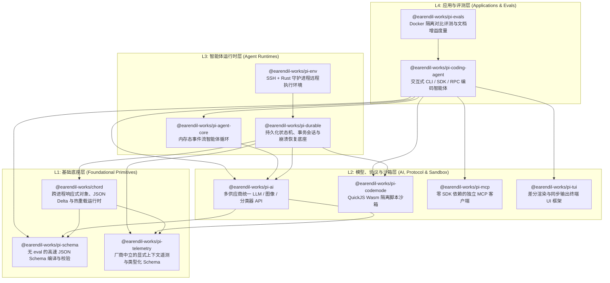

# Pi (`pi-mono`) 逆向需求说明书与功能说明书

本文档基于 [README.md](file:///d:/WebstormProjects/pi/README.md)、[AGENTS.md](file:///d:/WebstormProjects/pi/AGENTS.md) 及仓库内 12 个子包的文档与源码反向推导生成。全文严格遵循“**痛点问题 -> 具体场景/追踪 -> 设计方案 -> 必要性与解决的问题**”四步推导法，阐述每一项需求与功能点为何如此设计、以及落地后解决了什么工程问题。

---

## 核心术语定义

在阅读下文前，先明确项目中几个高频专有概念的定义：

- **Harness（智能体底座/运行器）**：管理模型请求、工具调度、上下文组装、持久化和扩展生命周期的宿主框架（如 [` packages/coding-agent `](file:///d:/WebstormProjects/pi/packages/coding-agent/README.md) 和 [` packages/durable `](file:///d:/WebstormProjects/pi/packages/durable/README.md)）。
- **CSP（Content Security Policy，内容安全策略）**：浏览器或边缘运行时（如 Cloudflare Workers）禁止在运行时通过 `eval()` 或 `new Function()` 动态生成并执行代码的沙箱安全限制。
- **Prompt Cache（提示词缓存）**：LLM 供应商（如 Anthropic、OpenAI）对请求中与上一轮完全一致的命名前缀（System Prompt + 工具定义 + 早期历史消息）进行 KV Cache 复用的机制；一旦前缀发生字节级变动，缓存即失效（Cache Miss）。
- **Group Commit（组提交）**：数据库与持久化系统中，当一个磁盘写入事务正在执行时，将后续到达的多个逻辑提交合并到同一个底层存储事务中批量落盘，从而摊销 I/O 往返延迟的技术。
- **Code Mode（代码模式）**：不让模型通过多次 JSON 工具调用在上下文里来回传递中间数据，而是让模型编写一段受限的 JavaScript 脚本，在沙箱内并发调用多个工具并过滤结果，最后仅将脚本最终输出返回给模型的执行模式。

---

# 第一部分：项目需求说明书 (Requirements Specification)

## 1. 项目愿景与核心定位

### 1.1 为什么需要 Pi？（核心痛点）
当前主流 AI Coding Agent（如 Claude Code、Cursor 等）普遍存在以下三类结构性问题：
1. **黑盒与工作流绑架**：内置了大量固化的子智能体（Sub-agents）、Plan 模式、特定权限弹窗和黑盒系统提示词。开发者必须让自己的工作流去适应工具，而无法按需裁剪或重构工具。
2. **运行时与部署形态割裂**：CLI 工具只能在本地 Node.js 终端跑，无法直接迁移到浏览器、Cloudflare Durable Objects 边缘节点或跨进程分布式环境；一旦进程崩溃或网络中断，执行中的多轮工具调用状态即丢失。
3. **上下文膨胀与高昂成本**：MCP（Model Context Protocol）服务器动辄暴露上百个工具，全量注入会导致首轮 Token 暴增；多轮工具调用的大体积输出直接塞回上下文，既挤占窗口又频繁破坏供应商 Prompt Cache。

### 1.2 核心设计哲学：“极简内核 + 极致可扩展”
Pi 的定位是 **“Minimal, extensible agent harness that you can make your own（可完全据为己有的极简、可扩展智能体底座）”**。
- **内核做减法**：默认只提供最核心的模型流式通信、4 个基础文件/命令工具（`read`、`write`、`edit`、`bash`）和会话树管理；**故意不内置**固化的 Sub-agents、Plan 模式或内置 OS 权限拦截器。
- **扩展做加法**：通过类型化扩展（Extensions）、按需技能（Skills）、提示词模板（Prompt Templates）、主题（Themes）和可分发的 Pi Packages，让用户（或让 Pi 自己写代码）构建专属的 Plan 模式、Sub-agents 或微虚拟机沙箱（如 Gondolin）。

---

## 2. 全局分层架构与模块依赖

Pi 采用单仓库多包（Monorepo）架构，自底向上分为四层，各包职责正交且严格控制依赖方向：

---

## 3. 核心业务与架构需求推导（R1 – R8）

以下逐一推导 Pi 最关键的 8 项核心需求，说明其背后的问题、具体追踪示例、设计方案及解决的问题。

### R1：无 `eval` 的高性能运行时 Schema 校验与宽松类型强制转换
- **问题背景**：
  智能体需要对模型生成的工具调用参数、MCP 动态下发的工具 Schema 以及跨进程 RPC 消息进行高频 JSON Schema 校验。主流库存在两难：
  1. **Ajv / TypeBox JIT** 依赖运行时 `new Function()` 生成代码，在严格 CSP 环境（如 Cloudflare Workers、浏览器扩展）下直接抛出 `EvalError` 崩溃；且每编译一个新 Schema 耗时高达数百微秒至数毫秒、占用大量堆内存。
  2. **Zod** 不是原生 JSON Schema 校验器，内存开销极大（3,200 个 Schema 占用 170 MB），且不支持大量 JSON Schema Draft 2020-12 关键字。
  3. **LLM 输出不规范**：小模型或量化模型经常把数字参数输出成字符串 `"10"`、把布尔值输出成 `"true"`、把单元素输出给数组字段、或把可选字段填为 `null`。
- **具体示例**：
  模型调用 `read` 工具时返回 `{ path: "a.txt", offset: "10", limit: null }`，其中 `offset` 要求为整数，`limit` 为可选整数。若直接严格校验会报错并浪费一轮 LLM 重试；若在 Cloudflare Worker 中用 Ajv 校验 MCP 动态传来的 Schema，会直接因 `EvalError` 失败。
- **设计方案**：
  设计 [`@earendil-works/pi-schema`](file:///d:/WebstormProjects/pi/packages/schema/src/index.ts)：
  1. [`compile()`](file:///d:/WebstormProjects/pi/packages/schema/src/validator.ts#L14-L27) 将 JSON Schema 一次性编译为**纯 JavaScript 闭包树（Plain Closures）**，完全不使用 `eval` 或 `new Function`。
  2. 区分快慢路径：[`Validator.check()`](file:///d:/WebstormProjects/pi/packages/schema/src/validator.ts#L33-L44) 仅返回布尔值并做 TypeScript 类型收窄，零对象分配；[`Validator.errors()`](file:///d:/WebstormProjects/pi/packages/schema/src/validator.ts#L50-L54) 仅在首次校验失败时惰性构建 [`Explainer`](file:///d:/WebstormProjects/pi/packages/schema/src/explain.ts)。
  3. 提供 [`CoercingValidator`](file:///d:/WebstormProjects/pi/packages/schema/src/validator.ts#L58-L77)，通过三趟转换（丢弃可选属性上的 `null` -> 基于关键字的类型转换 -> 基础类型兜底转换）自动修复模型松散输出。
- **必要性与解决的问题**：
  - **必要性**：MCP 工具和扩展 Schema 是在运行时动态到达的，无法在构建期预编译。
  - **解决的问题**：以 8.5 KB 的极小体积，同时实现了 Draft 2020-12/Draft 7 高兼容性（2222/2223 测试通过）、严格 CSP 环境下的百纳秒级校验（`read` 工具仅需 31 ns）、极低内存占用（3,200 个 Schema 仅 7.1 MB），并在工具边界静默消化了 LLM 的格式小瑕疵，消除了无意义的错误重试轮次。

---

### R2：跨供应商上下文无缝切换与 Prompt Cache 友好的增量系统消息
- **问题背景**：
  1. **跨模型切换崩溃**：用户在会话中途从 Claude 切换到 GPT-5 或 Gemini 时，历史消息中包含 Claude 专属的加密 `thinking` 签名块、未完成的中断消息或特定格式的 Tool Call，直接发给新供应商会导致 400 API 报错。
  2. **动态工具/提示词导致 Prompt Cache 失效**：当智能体在会话中途加载了新 Skill、连接了新 MCP 服务器或改变了状态时，传统做法是直接修改头部的 `systemPrompt` 或顶层 `tools` 数组。这会改变整个请求的前缀哈希，导致长达数万 Token 的历史上下文缓存全部失效（Cache Miss），成本和首字延迟（TTFT）剧增。
- **具体示例**：
  用户在第 10 轮对话启用了某个 MCP 工具，如果直接把该工具塞入第 1 轮之前的顶层 `tools` 列表，第 1~9 轮缓存的 80,000 Token 全部重新计费。
- **设计方案**：
  在 [`@earendil-works/pi-ai`](file:///d:/WebstormProjects/pi/packages/ai/src/index.ts) 中设计：
  1. **标准化的 `TranscriptContext` 与位置化 `SystemMessage`**：在 [`transcript.ts`](file:///d:/WebstormProjects/pi/packages/ai/src/utils/transcript.ts#L30-L120) 中，将系统提示词和工具集统一表示为消息流中的 `SystemMessage`（包含 `sections` 命名补丁与 `toolsAdded`/`toolsRemoved` 增量）。对于支持中途系统消息/增量工具的模型（如支持 `supportsMidConvoSystemMessages`、`supportsMidConvoToolChanges` 的 Anthropic / OpenAI Responses / Kimi 模型），在对话发生变更的位置**原地追加补丁消息或 `tool_addition` 块**；对于不支持的模型，通过 [`collapseSystemMessages()`](file:///d:/WebstormProjects/pi/packages/ai/src/utils/transcript.ts#L108-L112) 自动折叠回头部。
  2. **跨供应商清洗转换**：向不同模型发送历史记录时，保留同模型生成的 `thinking` 块与签名，自动剥离异构模型的 `thinking` 块（防止签名校验失败或思考内容被误认为正式回复），但完整保留文本、工具调用和图片结果。
- **必要性与解决的问题**：
  - **必要性**：多模型协作（如用快速模型探路、用推理模型攻坚、或在供应商宕机时切换）与长会话成本控制是生产级 Agent 的刚需。
  - **解决的问题**：实现了真正的**跨供应商热切换（Cross-Provider Handoff）**，同时在动态增删工具和更新系统提示词段落时**最大化保留供应商的 Prompt Cache 前缀命中率**。

---

### R3：显式、零全局状态的跨进程遥测与成本度量
- **问题背景**：
  OpenTelemetry 等传统方案重度依赖 Node.js 的 `AsyncLocalStorage` 隐式传递当前 Span，并绑定庞大的 SDK 与 Exporter。这带来两个问题：一是无法在所有边缘/浏览器环境保持一致行为，且并发任务/流式回调容易发生上下文串台；二是业务包被强绑定到特定监控后端。
- **具体示例**：
  当一个会话同时运行前台流式生成、后台自动压缩（Compaction）和多个并发子工具调用时，隐式全局 Span 极易将后台压缩的模型请求错误挂载到某个工具调用的 Span 下。
- **设计方案**：
  设计 [`@earendil-works/pi-telemetry`](file:///d:/WebstormProjects/pi/packages/telemetry/src/index.ts)：
  1. **显式回调生命周期**：[`TelemetryContext.startSpan(options, callback)`](file:///d:/WebstormProjects/pi/packages/telemetry/src/index.ts#L98-L103) 没有公开的 `end()` 方法，Span 的开启与结算完全由 `callback` 的返回值或 Promise 状态机托管。
  2. **无隐式全局状态**：所有父子关系通过显式传递 `TelemetrySpan`（或在 Chord/Durable 中通过 `Context` 参数末尾传递）建立；跨进程通过 JSON 安全的 [`TelemetryCarrier`](file:///d:/WebstormProjects/pi/packages/telemetry/src/index.ts#L10-L17) 注入与提取。
  3. **编译期类型化 Schema**：通过 [`defineTelemetrySchema()`](file:///d:/WebstormProjects/pi/packages/telemetry/src/index.ts#L175-L177) 和 [`createTypedSpanStarter()`](file:///d:/WebstormProjects/pi/packages/telemetry/src/index.ts#L451-L456)，在编译期严格校验 Span 名称、必填启动属性（`startAttributes`）和可选完成属性（`endAttributes`），运行时零校验开销。
- **必要性与解决的问题**：
  - **必要性**：库代码必须保持零后端依赖、零未闭合 Span 泄漏，且能在单测中断言精确的调用树。
  - **解决的问题**：彻底消除了“忘记调用 `span.end()`”导致的内存泄漏与并发 Span 错乱，让 `pi-ai`、`pi-durable`、`chord` 拥有统一的编译期安全遥测契约，并通过 [`InMemoryTelemetryContext`](file:///d:/WebstormProjects/pi/packages/telemetry/src/memory.ts) 在单元测试中直接做性能与成本守卫（Cost Guards）。

---

### R4：隔离沙箱化的“代码模式（Code Mode）”与工具搜索机制
- **问题背景**：
  当智能体需要批量处理数据或组合调用多个工具（例如：读取 20 个文件、筛选包含特定模式的配置、再对每条记录调用分类器或 GitHub MCP 工具）时：
  1. 传统 Tool Calling 需要多轮模型往返，或者一次性产生数十个 Tool Call，将几兆字节的原始文件/API 响应全部塞进 LLM 上下文，迅速撑爆 Context Window。
  2. 若连接了多个 MCP 服务器（上百个工具），将所有工具的 JSON Schema 全量放进每次请求的 `tools` 列表，静态开销就高达数万 Token。
- **具体示例**：
  用户要求：“检查仓库里所有 `package.json` 的依赖版本是否锁定”。如果用 `read` 工具逐个读入上下文，会消耗大量 Token；如果让模型直接跑 Bash 脚本，在无沙箱或云端受限环境下又有任意系统访问风险或缺乏跨平台工具桥接。
- **设计方案**：
  1. 设计 [`@earendil-works/pi-codemode`](file:///d:/WebstormProjects/pi/packages/codemode/src/index.ts)：将编译为 WebAssembly 的 **QuickJS 虚拟机**运行在独立 Worker 线程（Node/Bun 下的 [`CodemodeSandbox`](file:///d:/WebstormProjects/pi/packages/codemode/src/runtime/host.ts#L84-L88)）或独立部署的 Cloudflare Durable Object（[`RemoteCodemodeSandbox`](file:///d:/WebstormProjects/pi/packages/codemode/src/runtime/remote.ts)）中。
  2. 沙箱内**剥夺一切原生 I/O**（无文件系统、无网络、无定时器、无 `process`），唯一能力是通过宿主注入的 `await tools.<name>(args)` 桥接调用工具，并通过 `text()` / `image()` / `return` 输出精简后的最终结果。
  3. 配合 [`renderDeclarations()`](file:///d:/WebstormProjects/pi/packages/codemode/src/declarations.ts) 将工具 JSON Schema 渲染为紧凑的 TypeScript 类型声明，并对大规模工具集提供 `deferred` 延迟暴露与 BM25 `searchTools()` / `tool_search` 按需加载。
- **必要性与解决的问题**：
  - **必要性**：必须将“工具间的数据流转与过滤计算”从昂贵且缓慢的 LLM 上下文中卸载出来，同时保证模型生成代码的执行安全与可中断性（通过 `SharedArrayBuffer` 原子中断标志 + 轮询预算防止死循环卡死宿主）。
  - **解决的问题**：将原本需要 10 轮对话、消耗 100k Token 的批处理任务压缩为 **1 次 `codemode` 脚本调用**，中间工具调用结果完全不进入 LLM 上下文，大幅降低延迟与 Token 成本。

---

### R5：树状非破坏性会话存储（Session Tree）与精细化上下文压缩（Compaction）
- **问题背景**：
  1. **线性会话的破坏性回退**：开发者在探索代码方案时经常需要“回退到第 5 轮换一种思路”。如果直接截断历史，之前探索分支中读过的文件、踩过的坑和花费的账单数据就会永久丢失。
  2. **粗暴截断导致的上下文失忆与分裂**：当对话接近上下文上限时，简单的滑动窗口截断会丢弃用户的初始目标（Goal）和已修改文件列表；若在工具调用结果或超长单轮对话中间切一刀，会导致孤儿 `toolResult` 报错或前后文断裂。
- **具体示例**：
  用户在分支 A 尝试用方案 1 重构失败，想回到分叉点尝试方案 2，但希望把分支 A 中“为什么方案 1 行不通以及改了哪些文件”浓缩成一段摘要带入分支 B。
- **设计方案**：
  在 [`packages/coding-agent/src/core/session-manager.ts`](file:///d:/WebstormProjects/pi/packages/coding-agent/src/core/session-manager.ts) 与 [`packages/coding-agent/src/core/compaction/`](file:///d:/WebstormProjects/pi/packages/coding-agent/src/core/compaction/index.ts) 中：
  1. **Append-only 树状 JSONL**：每条记录带有 `id` 和 `parentId`（[`SessionEntryBase`](file:///d:/WebstormProjects/pi/packages/coding-agent/src/core/session-manager.ts#L57-L62)）。`/tree` 切换分支只需移动当前 `leaf` 指针；离开旧分支时可通过 [`generateBranchSummary()`](file:///d:/WebstormProjects/pi/packages/coding-agent/src/core/compaction/branch-summarization.ts) 自动寻找最近公共祖先（LCA），将旧分支濃縮为 [`BranchSummaryEntry`](file:///d:/WebstormProjects/pi/packages/coding-agent/src/core/session-manager.ts#L106-L115) 挂载到新分支。
  2. **非破坏性 Compaction 与 Split-Turn 处理**：压缩只追加一条 [`CompactionEntry`](file:///d:/WebstormProjects/pi/packages/coding-agent/src/core/session-manager.ts#L91-L104)（记录 `summary`、`firstKeptEntryId`、完整系统提示词快照 `systemMessage` 以及累积的 `readFiles`/`modifiedFiles`）。若单个用户回合超过了 `keepRecentTokens` 预算，自动识别为 **Split User-Message Span**，分别生成历史摘要与当前回合前缀摘要再合并，且绝不在 `toolResult` 处切断。
  3. **非破坏性上下文编辑（`ContextEditEntry`）**：当发生 Context Overflow 需要省略失败的助手尝试，或扩展需要改写某条历史消息时，仅追加一条 `context_edit` 记录，在 [`buildSessionProjection()`](file:///d:/WebstormProjects/pi/packages/coding-agent/src/core/session-manager.ts) 投影阶段生效，原始记录与计费统计丝毫无损。
- **必要性与解决的问题**：
  - **必要性**：长周期软件工程任务必然伴随多分支探索与上下文溢出恢复。
  - **解决的问题**：实现了如同 Git 一般的**对话分支切换与合并摘要**，在不丢失任何原始审计记录和费用统计的前提下，让智能体能够无限期持续工作而不迷失目标或丢失已读写文件追踪。

---

### R6：持久化事务型智能体状态机（Durable Harness）与崩溃恢复
- **问题背景**：
  在服务端、云端 Worker 或长耗时后台任务中，进程可能随时因重启、容器驱逐（如 Cloudflare Durable Objects 休眠/驱逐）、内存溢出（OOM）或断电而中断。普通的内存态智能体（如 `pi-agent-core`）一旦进程退出，正在进行的模型流、跑到一半的工具调用、排队中的用户输入以及重入的脚本就会彻底丢失或陷入无限崩溃循环（Crash Loop）。
- **具体示例**：
  一个后台智能体正在执行 `codemode` 脚本，脚本已经成功调用了 3 次工具，正在等待第 4 次工具调用时容器被平台重启。恢复后，不能把前 3 次可能有副作用的工具重新执行一遍，也不能让整个对话卡死在半途。
- **设计方案**：
  设计 [`@earendil-works/pi-durable`](file:///d:/WebstormProjects/pi/packages/durable/src/index.ts)：
  1. **单一串行变更线（Mutation Line）与 Group Commit**：所有对话记录（Entries）、状态机任务（Tasks）、提交队列（Submissions）和 JSON 文档（Documents）的修改必须通过原子事务 [`Session.commit()`](file:///d:/WebstormProjects/pi/packages/durable/src/session/session.ts) 落盘后才对外可见；通过 [`Writer`](file:///d:/WebstormProjects/pi/packages/durable/src/session/writer.ts) 实现 Group Commit，在保证严格线序的同时将吞吐量提升约 10 倍。
  2. **显式检查点任务状态机（Durable Tasks）**：将模型生成（[`GenerationTask`](file:///d:/WebstormProjects/pi/packages/durable/src/harness/generation.ts)）、工具调用（[`ToolTask`](file:///d:/WebstormProjects/pi/packages/durable/src/harness/tool.ts)）、上下文压缩（[`CompactionTask`](file:///d:/WebstormProjects/pi/packages/durable/src/harness/compaction.ts)）全部建模为带持久化 Checkpoint 的阶段状态机（Phases）。
  3. **重放安全策略（Replay Policy）与确定性脚本恢复**：工具显式声明 `replay: "safe"` 时才在崩溃后重跑，且嵌套工具调用按调用序号/Key 自动重连已持久化的 [`NestedCallDoc`](file:///d:/WebstormProjects/pi/packages/durable/src/harness/tool.ts)；Durable Code Mode 结合确定性沙箱（固定时间、随机种子、时区）与结果日志（Journal），在进程重启后无副作用地快进重放到断点继续执行。
  4. **防崩溃死循环（Crash Loop Protection）**：统计每个任务在同一 Checkpoint 下的被中断重启次数，超过 `settings.restartLimit`（默认 5 次）则自动终止并标记为 `restart_limit` / `faulted`，避免导致 OOM 的恶意或缺陷任务无限重启打挂集群。
- **必要性与解决的问题**：
  - **必要性**：云原生与长周期自主智能体必须具备数据库级别的 ACID 事务保障与确定性故障恢复能力。
  - **解决的问题**：做到了**“任何时刻拔掉电源或杀掉进程，重新打开存储即可从最后一个检查点精确恢复”**，同时彻底解决了流式进度高频写入的 I/O 瓶颈（通过 `deferred` 延迟提交）与 Crash Loop 雪崩问题。

---

### R7：无闪烁终端 UI（Differential + Synchronized Output）与双缓冲模式
- **问题背景**：
  在终端里实时流式渲染 Markdown、代码高亮、多行编辑器、内联图片和弹出菜单时，传统 CLI 方案要么不断全屏清屏重绘导致严重闪烁（Flicker）和滚轮历史丢失，要么在使用中文/日文输入法（IME）时候选词窗口乱跳，要么在大段文本粘贴时把终端卡死或误触发多次回车提交。
- **具体示例**：
  模型以每秒 100 Token 的速度流式输出带语法高亮的 Markdown 表格，同时用户在底部多行输入框中用中文输入法打字準備下一条 Steering 指令。
- **设计方案**：
  设计 [`@earendil-works/pi-tui`](file:///d:/WebstormProjects/pi/packages/tui/src/index.ts)：
  1. **双渲染器架构**：提供共享 [`TUI`](file:///d:/WebstormProjects/pi/packages/tui/src/tui.ts#L174) 接口的 [`TuiMainScreen`](file:///d:/WebstormProjects/pi/packages/tui/src/tui-main-screen.ts)（保留终端原生滚轮回溯，仅差分重绘首个变化行及其下方区域）与 [`TuiAltScreen`](file:///d:/WebstormProjects/pi/packages/tui/src/tui-alt-screen.ts)（全屏交替缓冲区，支持 Flexbox 风格的 `VStack`/`HStack`/`ScrollView` 独立滚动视口、鼠标点选拖拽、OSC 52 自动复制和 `Ctrl+Shift+F` 全文搜索）。
  2. **CSI 2026 同步输出（Synchronized Output）**：每次差分帧更新前后包裹 `\x1b[?2026h` 与 `\x1b[?2026l`，让现代终端（Kitty、Ghostty、WezTerm、iTerm2 等）在内存缓冲完整帧后再原子刷新屏幕。
  3. **零宽 APC 光标标记（`CURSOR_MARKER`）与 Fake Cursor**：在渲染文本中插入零宽转义序列定位聚焦组件光标，在绘制反色假光标的同时将硬件光标暗中移动到准确位置，完美对齐中英文 IME 候选框。
- **必要性与解决的问题**：
  - **必要性**：编码智能体的核心交互界面在终端，UI 响应速度与视觉稳定性直接决定使用体验。
  - **解决的问题**：实现了**零闪烁的流式富文本渲染**、准确的中文 IME 光标跟随、Kitty/iTerm2 终端内联图片显示（含 AltScreen 滚动裁剪兼容），以及大文本粘贴自动折叠（`[paste #1 +50 lines]`）。

---

### R8：科学的智能体行为与文档增益评测（Paired Documentation-Lift Evals）
- **问题背景**：
  当开发者为 Pi 编写扩展、配置或 SDK 文档时，如何证明“这段文档真的帮模型写出了正确的代码”，而不是凭感觉写文档？普通测试只能测确定性代码，而 LLM 评测往往受限于随机性（Flakiness）、容器环境污染或模型在容器里偷看源码作弊。
- **具体示例**：
  修改了 `docs/extensions.md` 中关于 `registerProvider` 的说明后，需要量化评估模型在有文档和无文档两种条件下完成“注册自定义模型供应商”任务的成功率差异（Lift）。
- **设计方案**：
  设计 [`@earendil-works/pi-evals`](file:///d:/WebstormProjects/pi/packages/evals/README.md)：
  1. **成对隔离镜像构建**：自动将当前工作区打包，构建 `without_docs`（剥离文档、示例及系统提示词中的文档路由指南，且对称移除内部依赖包的源码与文档防止模型偷看）和 `with_docs` 两个 Docker 镜像。
  2. **特权降级防作弊**：评测题定义、评分器（Judges）与 Fixtures 在容器内归属 `root` 且权限不可读，容器启动后永久降权到普通 UID 运行 Pi。
  3. **交替重复与严格配对报告**：按运行轮次交替执行对照组与实验组以消除时间段偏差，仅当成对 Arm 均产生唯一有效分数时才计算整体 Lift（增益），否则阻断汇总报告。
- **必要性与解决的问题**：
  - **必要性**：Pi 奉行“不内置花哨功能，让用户要求 Pi 根据文档自己写扩展”的理念，因此**文档就是给 LLM 看的接口规范**，其质量必须可量化验证。
  - **解决的问题**：建立了防作弊、可重复的 A/B 对照评测流水线，用实证数据指导文档和提示词的迭代。

---

## 4. 非功能性需求（安全性、供应链与跨平台）

### 4.1 供应链硬化（Supply-Chain Hardening）
- **问题背景**：npm 生态频繁发生传递依赖投毒与恶意 `postinstall` 脚本攻击，而编码智能体拥有用户本机的完整文件与 Shell 权限。
- **设计方案与解决的问题**：
  1. **精确版本锁定与冷却期**：所有直接外部依赖强制使用精确版本号（无 `^` 或 `~`），由 [`scripts/check-pinned-deps.mjs`](file:///d:/WebstormProjects/pi/scripts/check-pinned-deps.mjs) 在 `npm run check` 时强制校验；`.npmrc` 设置 `min-release-age=2` 避开当日发布的未审查版本。
  2. **全面禁用生命周期脚本**：安装与更新默认使用 `--ignore-scripts`；[`scripts/generate-coding-agent-install-lock.mjs`](file:///d:/WebstormProjects/pi/scripts/generate-coding-agent-install-lock.mjs) 生成独立的安装锁文件，并维护严格的生命周期脚本白名单，任何新增带脚本的依赖都会直接令 CI 失败。
  3. **Project Trust（项目信任门禁）**：在加载任何工作区本地配置（`.pi/settings.json`）、本地扩展（`.pi/extensions`）或本地技能前，必须先通过 [`ProjectTrustStore`](file:///d:/WebstormProjects/pi/packages/coding-agent/src/core/trust-manager.ts) 或 `project_trust` 事件确认信任该目录，防止克隆恶意仓库后打开 `pi` 即触发 RCE（远程代码执行）。

### 4.2 Node.js 原生类型擦除（Strip-Only TypeScript）
- **问题背景**：如果在源码中使用 TypeScript 特有的运行时语法（如 `enum`、`namespace`、构造函数参数属性 `constructor(private x: number)`），则必须依赖构建工具转译才能运行，无法用 Node.js 22+ 的 `--experimental-strip-types` 直接执行源码。
- **设计方案与解决的问题**：全仓强制使用可擦除 TypeScript 语法（Erasable Syntax Only）并保留 `.ts` 相对导入后缀（由 [`scripts/check-ts-relative-imports.mjs`](file:///d:/WebstormProjects/pi/scripts/check-ts-relative-imports.mjs) 检查）。这使得测试、示例脚本（如 `node --conditions=source --experimental-strip-types`）和开发调试无需编译即可秒级直接运行。

---

# 第二部分：项目功能说明书 (Functional Specification)

本部分按架构层级逐一拆解全部 12 个模块的核心功能、API/数据结构、内部机制，并重点阐述每个功能点的**设计原因**与**解决的问题**。

---

## 模块一：`@earendil-works/pi-schema` —— 零 `eval` 的 JSON Schema 编译器与转换器

- **模块路径**：[`packages/schema`](file:///d:/WebstormProjects/pi/packages/schema/README.md)
- **核心入口**：[`packages/schema/src/index.ts`](file:///d:/WebstormProjects/pi/packages/schema/src/index.ts)、[`validator.ts`](file:///d:/WebstormProjects/pi/packages/schema/src/validator.ts)、[`compiler.ts`](file:///d:/WebstormProjects/pi/packages/schema/src/compiler.ts)、[`coerce.ts`](file:///d:/WebstormProjects/pi/packages/schema/src/coerce.ts)

### 1. 核心功能清单
1. **类型化 JSON Schema 构建器（[`builders.ts`](file:///d:/WebstormProjects/pi/packages/schema/src/builders.ts)）**：
   - 提供 `str()`、`num()`、`int()`、`bool()`、`nul()`、`lit()`、`oneOf()`、`obj()`、`opt()`、`arr()`、`tuple()`、`map()`、`union()`、`nullable()`、`bytes()`。
   - 返回纯正的 JSON Schema 普通对象（可直接 `JSON.stringify` 发送给 LLM 供应商），同时通过符号类型推断 [`Static<typeof S>`](file:///d:/WebstormProjects/pi/packages/schema/src/builders.ts) 提供静态 TypeScript 类型，并兼容推断 TypeBox 1.x 构建的 Schema。
2. **无代码生成的闭包编译器（[`Compiler`](file:///d:/WebstormProjects/pi/packages/schema/src/compiler.ts)）**：
   - 支持 Draft 2020-12 与 Draft 7 的全部核心校验关键字（含 `$ref`、`$dynamicRef`、`unevaluatedProperties`、`unevaluatedItems` 等）。
   - 将每个 Schema 节点编译为一个 `(value: unknown) => boolean` 闭包函数并组合。
3. **惰性错误解释器（[`Explainer`](file:///d:/WebstormProjects/pi/packages/schema/src/explain.ts)）与三阶段类型强制转换（[`Coercer`](file:///d:/WebstormProjects/pi/packages/schema/src/coerce.ts)）**：
   - 产出精确到字段 JSON Pointer 路径的错误报告（如 `{ path: "/offset", keyword: "minimum", message: "expected >= 1" }`）。
   - 支持悬空引用局部拒绝（`unresolvedRefs: "reject"`）。

### 2. 重点设计剖析：为什么这样设计？解决了什么问题？

#### (1) 为什么 `obj()` 默认是闭合对象（`additionalProperties: false`），且缺失/未知字段报错直接指向字段路径？
- **原因**：
  1. OpenAI、Anthropic 等供应商的 Strict Structured Outputs（严格受限采样）强制要求对象 Schema 必须声明 `additionalProperties: false`。
  2. 标准 JSON Schema 在父对象上报告 `required` 错误（路径为 `""`），在模型修正工具参数时不够直观。
- **解决的问题**：构建出的 Schema 天然符合各大模型供应商的 Strict Tool Calling 规范，且当模型漏填或错填参数名时，直接收到 `/fieldName: missing` 或 `/extraField: unknown field`，模型单次自我修正成功率显著提高。

#### (2) 为什么对带字面量标签的联合类型（Tagged Unions）做专门的分支派发优化？
- **原因**：在协议帧（如 Chord 的 `Frame`）和内容块（如 `TextContent | ImageContent`）中，大量使用由 `lit("text")` 区分的 `union([...])`。如果按通用 `anyOf` 逐个分支尝试，不仅慢，而且失败时会报出所有分支的庞大错误列表。
- **解决的问题**：当 `union` 识别到每个对象分支拥有同一个枚举/字面量判别属性（Discriminator）时，编译出的闭包直接读取该属性并做哈希/Switch 派发，只执行匹配的唯一分支；若标签本身非法，直接在标签路径报错 `expected one of ["text", "image"]`。

#### (3) 为什么提供 `unresolvedRefs: "reject"` 选项？
- **原因**：第三方 MCP 服务器返回的工具 `inputSchema` 经常包含指向外部未捆绑文档或拼写错误的 `$ref`。如果编译期直接抛出异常，会导致整个 MCP 服务器连接失败或所有工具不可用。
- **解决的问题**：开启 `unresolvedRefs: "reject"` 后，无法解析的 `$ref` 被编译为恒假断言，仅当实际调用传入了触及该子节点的参数时才报错 `unresolved reference <ref>`，Schema 的其余部分依然正常工作。

---

## 模块二：`@earendil-works/pi-telemetry` —— 显式上下文与零运行时开销的类型化遥测

- **模块路径**：[`packages/telemetry`](file:///d:/WebstormProjects/pi/packages/telemetry/README.md)
- **核心入口**：[`packages/telemetry/src/index.ts`](file:///d:/WebstormProjects/pi/packages/telemetry/src/index.ts)、[`memory.ts`](file:///d:/WebstormProjects/pi/packages/telemetry/src/memory.ts)、[`render.ts`](file:///d:/WebstormProjects/pi/packages/telemetry/src/render.ts)

### 1. 核心功能清单
1. **核心契约（[`TelemetryContext`](file:///d:/WebstormProjects/pi/packages/telemetry/src/index.ts#L98-L103) & [`TelemetrySpan`](file:///d:/WebstormProjects/pi/packages/telemetry/src/index.ts#L105-L110)）**：
   - `startSpan(options, callback)` 创建子 Span 并同步执行一次 `callback`，等待返回值或 Promise Settle 后自动关闭 Span。
   - 支持属性合并（`setAttributes`）、时间点事件（`addEvent`）、跨 Trace 关联链接（`addLink`）和状态覆盖（`setStatus`）。
2. **传播与指标（[`TelemetryPropagation`](file:///d:/WebstormProjects/pi/packages/telemetry/src/index.ts#L13-L17) & [`TelemetryMetrics`](file:///d:/WebstormProjects/pi/packages/telemetry/src/metrics.ts)）**：
   - `inject`/`extract` 实现跨进程 JSON Carrier 传播。
   - 支持 `counter`、`upDownCounter`、`histogram`（含 Exemplar 关联）。
3. **编译期 Schema 绑定（[`createTypedSpanStarter`](file:///d:/WebstormProjects/pi/packages/telemetry/src/index.ts#L451-L456) & [`createTypedMetrics`](file:///d:/WebstormProjects/pi/packages/telemetry/src/metrics.ts)）**：
   - 将静态 JSON Schema 定义转化为函数重载，在编译期拦截拼写错误的 Span 名、未声明的事件或高基数（`cardinality: 'high'`）指标属性。
4. **内存参考实现、存储查询与一致性套件**：
   - [`InMemoryTelemetryContext`](file:///d:/WebstormProjects/pi/packages/telemetry/src/memory.ts) 提供确定性序号快照（用于测试断言）与 [`TelemetryStore`](file:///d:/WebstormProjects/pi/packages/telemetry/src/index.ts#L91-L95) 查询接口。
   - [`createTelemetryAdapterConformance()`](file:///d:/WebstormProjects/pi/packages/telemetry/src/testing.ts) 提供与测试框架无关的适配器合规测试集。

### 2. 重点设计剖析：为什么这样设计？解决了什么问题？

#### (1) 为什么区分 `startAttributes`（必填或可选）和 `endAttributes`（永远可选）？
- **原因**：在真实的异步操作（如请求 LLM 或读取账户）中，操作目标（如 `provider: "openai"`）在 Span 启动时即已知；而结果特征（如 `input_tokens: 500`、`item_count: 12`）只有在异步工作完成后才能获知。如果中途发生异常、超时取消或特定供应商未返回某字段，完成属性可能根本不存在。
- **解决的问题**：既在编译期强制要求调用者在启动 Span 时传入所有已知上下文属性，又允许在回调执行期间通过 `span.setAttributes()` 渐进式补充完成属性，且不会因为异常分支未调用 `setAttributes()` 而产生编译报错或数据丢失。

#### (2) 为什么 `InMemoryTelemetryContext.getSpans()` 返回的快照不包含时间戳，而是使用确定性递增 ID 与结束序号？
- **原因**：测试代码如果依赖真实时钟（Wall-clock timestamps），在并发异步测试中会出现非确定性的时序抖动（Flaky tests）。
- **解决的问题**：将“面向单元测试的确定性结构快照（`getSpans()`）”与“面向诊断查询的带时间戳存储（`TelemetryStore.findTraces()`）”解耦，使得所有遥测断言测试 100% 确定可重现。

---

## 模块三：`@earendil-works/chord` —— 跨进程响应式对象、JSON Delta 与热重载运行时

- **模块路径**：[`packages/chord`](file:///d:/WebstormProjects/pi/packages/chord/README.md)
- **核心入口**：[`packages/chord/src/index.ts`](file:///d:/WebstormProjects/pi/packages/chord/src/index.ts)、[`packages/chord/src/next/index.ts`](file:///d:/WebstormProjects/pi/packages/chord/src/next/index.ts)、[`packages/chord/src/delta/index.ts`](file:///d:/WebstormProjects/pi/packages/chord/src/delta/index.ts)

### 1. 核心功能清单
1. **事务型 JSON 增量追踪器（[`@earendil-works/chord/delta`](file:///d:/WebstormProjects/pi/packages/chord/src/delta/index.ts)）**：
   - 通过 [`track(initial)`](file:///d:/WebstormProjects/pi/packages/chord/src/delta/index.ts) 与 Proxy 草稿（`Draft`）捕获对 JSON 状态树的修改，生成紧凑的元组操作码 [`Op`](file:///d:/WebstormProjects/pi/packages/chord/src/delta/index.ts#L33-L40)：全量替换 `["r", val]`、属性设置 `["s", path, val]`、删除 `["d", path]`、字符串追加 `["a", path, str]`、字符串头部截断 `["t", path, count]`、数组切片 `["p", path, idx, del, ins]`、数组重排 `["m", path, perm]`。
   - [`WireOp`](file:///d:/WebstormProjects/pi/packages/chord/src/delta/index.ts#L50-L66) 在跨边界传输时对第二次出现的路径自动分配数字字典 ID `["#", id, path]`，并省略与上一条指令相同的路径。
2. **受控输出流与自适应进度节流（[`@earendil-works/chord/output`](file:///d:/WebstormProjects/pi/packages/chord/src/output/index.ts)）**：
   - `OutputBuffer` 维护流式输出的首尾滑动窗口（Head/Tail limits），超出部分自动生成跳过标记（`OutputSkip`）；`Progress` 对高频变化的流式状态做自适应批量提交。
3. **单监听者折叠观察句柄（[`Watch<T>` / `WatchHandle<T>`](file:///d:/WebstormProjects/pi/packages/chord/src/watch.ts)）**：
   - 为 Durable 的文档、对话视图和任务图提供统一的异步流式订阅接口。
4. **跨进程可热重载对象宿主（Chord v1 & Chord v2 [`packages/chord/src/next`](file:///d:/WebstormProjects/pi/packages/chord/docs/next/design.md)）**：
   - 将应用建模为分布在 Server、Workers、Browser Tabs 中的地址化对象（Objects = State + Code at an Address）。
   - 调用方永远只持有引用（`Reference`），支持基于身份（`Principal`）的权限变体（Variants）、跨 IPC/WebSocket 的自动重连（Hold 重建），以及运行中插件代码的热重载（Hot Reload）与状态迁移。

### 2. 重点设计剖析：为什么这样设计？解决了什么问题？

#### (1) 为什么 JSON Delta 专门设计了字符串追加 `["a"]`、字符串截断 `["t"]` 和 `ownedSlice()`？
- **原因**：
  1. 在智能体运行过程中，最频繁的状态变更是**流式追加模型回复文本**和**流式追加 Bash 终端输出（并在超出上限时截断头部）**。如果用普通的 JSON Patch（RFC 6902），每次追加几个字符都要把长达几十 KB 的完整字符串重新发一遍（`replace`），网络带宽与序列化开销呈 $O(N^2)$ 爆炸。
  2. 在 V8 引擎中，`text.slice(start, end)` 截取长度 $\ge 13$ 的子串时会创建一个指向原大字符串的 `SlicedString` 视图。如果直接把 `slice` 出来的增量放进 Delta 操作列表或 Watch 队列，几兆字节的原始大字符串就会被这些小切片在内存中一直钉死无法 GC。
- **解决的问题**：
  - 通过 [`overlap()`](file:///d:/WebstormProjects/pi/packages/chord/src/delta/index.ts#L87-L110) 自动识别滚动窗口的字符串尾部追加与头部截断，将流式输出的同步复杂度从 $O(N^2)$ 降为 $O(N)$。
  - 通过 [`ownedSlice()`](file:///d:/WebstormProjects/pi/packages/chord/src/delta/index.ts#L118-L120)（`${text.slice(start, end)} `.slice(0, -1)）强制 V8 分配独立的扁平字符串副本，彻底消除了长会话流式输出中的 V8 `SlicedString` 内存泄漏。

#### (2) 为什么 `WatchHandle` 在消费者处理缓慢时要折叠（Fold）待处理的操作，并在超过 10,000 个 Op 时退化为一次全量替换 `[["r", newest]]`？
- **原因**：当慢速网络客户端或繁忙的 UI 渲染器正在处理上一帧回调时，后台智能体可能已经产生了上百次流式提交。如果逐帧排队发送，客户端会严重滞后（Lag）且积压海量中间对象。
- **解决的问题**：通过 `PendingOps` 将积压帧的操作在内存中合并（例如对同一字符串的多次 `["a"]` 合并为一次 `["a"]`，对同一字段的多次 `["s"]` 只保留最后一次），如果合并后仍超过 10,000 条指令则直接发送最新快照 `[["r", newest]]`，天然实现了**無锁背压（Backpressure）与慢消费者自适应追赶**。

---

## 模块四：`@earendil-works/pi-tui` —— 差分渲染与同步输出的终端 UI 框架

- **模块路径**：[`packages/tui`](file:///d:/WebstormProjects/pi/packages/tui/README.md)
- **核心入口**：[`packages/tui/src/index.ts`](file:///d:/WebstormProjects/pi/packages/tui/src/index.ts)、[`tui.ts`](file:///d:/WebstormProjects/pi/packages/tui/src/tui.ts)、[`tui-main-screen.ts`](file:///d:/WebstormProjects/pi/packages/tui/src/tui-main-screen.ts)、[`tui-alt-screen.ts`](file:///d:/WebstormProjects/pi/packages/tui/src/tui-alt-screen.ts)

### 1. 核心功能清单
1. **双模式渲染引擎**：
   - [`TuiMainScreen`](file:///d:/WebstormProjects/pi/packages/tui/src/tui-main-screen.ts)：在终端主缓冲区渲染，保留原生滚动条历史，对比前后两帧字符串数组，仅将光标移动到第一个发生变化的行向下重绘。
   - [`TuiAltScreen`](file:///d:/WebstormProjects/pi/packages/tui/src/tui-alt-screen.ts)：在交替屏幕缓冲区管理固定高度视口，支持 [`VStack`](file:///d:/WebstormProjects/pi/packages/tui/src/components/v-stack.ts)、[`HStack`](file:///d:/WebstormProjects/pi/packages/tui/src/components/h-stack.ts)、[`ScrollView`](file:///d:/WebstormProjects/pi/packages/tui/src/components/scroll-view.ts) 弹性布局、鼠标滚轮链式传递、鼠标拖拽选词复制（OSC 52）、OSC 133 语义提示符跳转及内置搜索面板。退出时自动恢复主屏幕并打印完整最终文档。
2. **色彩空间转换与主题系统（[`colors.ts`](file:///d:/WebstormProjects/pi/packages/tui/src/colors.ts)）**：
   - 支持 ANSI 索引色、sRGB、OKLCH 和 **OKHSL** 色彩解析与混色（`mixColors`），按终端能力自动降级为 Truecolor 或 256 色。
3. **富交互组件库**：
   - [`Editor`](file:///d:/WebstormProjects/pi/packages/tui/src/components/editor.ts)（多行编辑、自动换行、`/` 斜杠命令与 `@`/`Tab` 文件路径自动补全、大段粘贴折叠）、[`Markdown`](file:///d:/WebstormProjects/pi/packages/tui/src/components/markdown.ts)（带缓存的流式 Markdown 与代码高亮）、[`Image`](file:///d:/WebstormProjects/pi/packages/tui/src/components/image.ts)（Kitty / iTerm2 终端图片协议支持）、[`SelectList`](file:///d:/WebstormProjects/pi/packages/tui/src/components/select-list.ts)、[`SettingsList`](file:///d:/WebstormProjects/pi/packages/tui/src/components/settings-list.ts)、图层叠放 [`showOverlay`](file:///d:/WebstormProjects/pi/packages/tui/src/tui.ts)。

### 2. 重点设计剖析：为什么这样设计？解决了什么问题？

#### (1) 为什么同时提供 `TuiMainScreen` 和 `TuiAltScreen`，且在 `TuiAltScreen` 退出时将完整内容重新输出到主屏幕？
- **原因**：
  - 许多命令行极客习惯使用终端模拟器自带的滚轮回溯、Cmd+F 搜索和鼠标选词（这要求使用 `TuiMainScreen`）；
  - 但当对话历史极长、底部编辑器固定或需要复杂弹窗/鼠标点击交互时，主屏幕一旦有上方内容变化（如折叠/展开某个工具输出）就必须清屏重绘，体验受限（这需要 `TuiAltScreen` 独立管理滚动视口）；
  - 传统全屏 TUI 程序（如 `vim`、`htop`）退出后交替屏幕关闭，刚才看到的所有输出在终端里瞬间消失，用户无法对照刚才的回答继续敲命令。
- **解决的问题**：让用户可通过设置无缝切换两种体验；且在 `TuiAltScreen` 退出时，渲染器自动调用根组件的无界 `render(width)` 将整个会话内容打印回主屏幕，兼顾了运行时的全屏视口操控感与退出后的终端上下文留存。

#### (2) 为什么在 `TuiAltScreen` 下允许 Kitty 协议渲染图片，却将 iTerm2 图片协议降级为文本占位符？
- **原因**：在交替屏幕中，用户上下滚动 `ScrollView` 时，图片可能只有一半在视口内，或者滑出视口后原位置被文字覆盖。Kitty 图形协议支持按 ID 删除已有图片放置（Placement）以及对源图像进行垂直像素裁剪；而 iTerm2 的内联图片协议是一次性写入字符流，既无法删除已绘制的图片，也无法裁剪，滚动时会导致旧图片残留在新绘制的文字上方造成画面撕裂。
- **解决的问题**：通过对终端图形协议能力的精确区分（[`terminal-image.ts`](file:///d:/WebstormProjects/pi/packages/tui/src/terminal-image.ts)），避免了 iTerm2 用户在全屏滚动模式下出现无法擦除的图像残影 Bug。

---

## 模块五：`@earendil-works/pi-codemode` —— 基于 QuickJS Wasm 的受限代码执行沙箱

- **模块路径**：[`packages/codemode`](file:///d:/WebstormProjects/pi/packages/codemode/README.md)
- **核心入口**：[`packages/codemode/src/index.ts`](file:///d:/WebstormProjects/pi/packages/codemode/src/index.ts)、[`host.ts`](file:///d:/WebstormProjects/pi/packages/codemode/src/runtime/host.ts)、[`remote.ts`](file:///d:/WebstormProjects/pi/packages/codemode/src/runtime/remote.ts)、[`declarations.ts`](file:///d:/WebstormProjects/pi/packages/codemode/src/declarations.ts)

### 1. 核心功能清单
1. **三态统一沙箱实现**：
   - [`CodemodeSandbox`](file:///d:/WebstormProjects/pi/packages/codemode/src/runtime/host.ts#L84-L88)（Node/Bun）：每次 `execute()` 启动一个独立 Worker 线程并实例化全新的 QuickJS WebAssembly 虚拟机。
   - [`RemoteCodemodeSandbox`](file:///d:/WebstormProjects/pi/packages/codemode/src/runtime/remote.ts)（Cloudflare Workers）：将 VM 放到另一个独立部署的 Sandbox Worker 的 Durable Object 中运行，工具调用通过 Workers RPC 回调给会话 DO。
   - [`InlineCodemodeSandbox`](file:///d:/WebstormProjects/pi/packages/codemode/src/runtime/inline.ts)：在调用线程直接运行（适用于允许阻塞的单次无状态请求）。
2. **脚本环境与键值存储**：
   - 注入 `tools.<name>(args)`、`ALL_TOOLS`、`text()`、`image()`、`console.*`、`exit()`、`store(k, v)` / `load(k)`。
   - 支持首行指令 `// @options: {"max_output_tokens": 2000, "timeout_ms": 30000}` 及 OpenAI Lark 语法约束 [`CODEMODE_SOURCE_GRAMMAR`](file:///d:/WebstormProjects/pi/packages/codemode/src/source.ts)。
3. **确定性重放模式（[`sandbox.start()`](file:///d:/WebstormProjects/pi/packages/codemode/src/runtime/execution.ts)）**：
   - 固定虚拟时钟（`startedAt` + 每次结果返回的 `now`）、PRNG 随机种子（`seed`）、固定 UTC 时区、移除 `WeakRef`/`FinalizationRegistry`，并严格按结果序号投递异步回调。

### 2. 重点设计剖析：为什么这样设计？解决了什么问题？

#### (1) 为什么在 Node/Bun 下不仅调用 `worker.terminate()`，还要配合 `SharedArrayBuffer` 原子中断标志和 `worker.unref()`？
- **原因**：查看 [`packages/codemode/src/runtime/host.ts`](file:///d:/WebstormProjects/pi/packages/codemode/src/runtime/host.ts#L12-L66) 的源码注释可知：在 Bun 运行时中，当 Worker 线程正在 WebAssembly 内部执行死循环（如 `while (true) {}`）时，`worker.terminate()` 无法打断它；此外，如果脚本调用了某个耗时极长的原生内置方法（未轮询 QuickJS 中断处理器），`terminate()` 会内部 `ref` 该 Worker 导致宿主进程无法退出且阻塞取消操作。
- **解决的问题**：宿主在超时或取消时，先通过 `Atomics.store(new Int32Array(interrupt), 0, 1)` 置位共享内存中断标志（让 QuickJS 字节码循环立即主动退出），再异步调用 `worker.terminate()` 并立刻 `worker.unref()`，保证无论模型写出怎样的死循环代码，取消和超时都能立即向调用方返回且不拖慢宿主。

#### (2) 为什么在 Cloudflare Workers 上，`RemoteCodemodeSandbox` 必须把 QuickJS 放在“另一个独立部署的 Worker 的 Durable Object”中，而不是当前 DO 或 Dynamic Worker？
- **原因**：QuickJS 是同步执行的解释器。如果在会话所在的 Durable Object 内部（或由该 DO 启动的 Dynamic Worker 中）运行一段同步计算 10 秒的脚本，实测会将发往该会话 DO 的所有其他并发请求（如 UI 状态订阅、取消指令）全部阻塞整整 10 秒！而将其放到独立部署的另一个 Worker 的 Durable Object 中，跨 Worker RPC 隔离了执行线程，对主会话 DO 的延迟影响降至约 50 ms。
- **解决的问题**：保证了云端多租户 Agent 会话在运行计算密集型模型脚本时，主会话依然能实时响应用户的流式订阅与 `Abort` 中断请求。

---

## 模块六：`@earendil-works/pi-mcp` —— 零官方 SDK 依赖的轻量级 MCP 客户端

- **模块路径**：[`packages/mcp`](file:///d:/WebstormProjects/pi/packages/mcp/README.md)
- **核心入口**：[`packages/mcp/src/index.ts`](file:///d:/WebstormProjects/pi/packages/mcp/src/index.ts)、[`client.ts`](file:///d:/WebstormProjects/pi/packages/mcp/src/client.ts)、[`stdio.ts`](file:///d:/WebstormProjects/pi/packages/mcp/src/transports/stdio.ts)、[`streamable-http.ts`](file:///d:/WebstormProjects/pi/packages/mcp/src/transports/streamable-http.ts)

### 1. 核心功能清单
1. **传输层解耦的客户端核心（[`McpClient`](file:///d:/WebstormProjects/pi/packages/mcp/src/client.ts)）**：
   - 支持协议版本协商（`2025-11-25` 向下兼容至 `2024-11-05`）、分页 `tools/list`、`tools/call`（含 `structuredContent`）、进度通知（Progress notifications）自动续期超时计时器、请求取消（Cancellation）以及服务端发起的 `ping` 和 `roots/list`。
2. **双传输实现与优雅进程组清理**：
   - [`StdioTransport`](file:///d:/WebstormProjects/pi/packages/mcp/src/transports/stdio.ts)：管理本地子进程，关闭时严格按规范执行 `close stdin -> SIGTERM -> SIGKILL`，且作用于**整个进程组（Process Group）**。
   - [`StreamableHttpTransport`](file:///d:/WebstormProjects/pi/packages/mcp/src/transports/streamable-http.ts)：支持会话保持、服务端推送 GET 流断线重连，以及通过 `Last-Event-ID` 恢复中断的响应流。
3. **OAuth 2.1 PKCE 认证子模块（[`@earendil-works/pi-mcp/oauth`](file:///d:/WebstormProjects/pi/packages/mcp/src/oauth/index.ts)）与内容转换器（[`toLlmContent`](file:///d:/WebstormProjects/pi/packages/mcp/src/protocol/content.ts#L15)）**：
   - 支持受保护资源元数据发现、动态客户端注册（DCR）、PKCE 授权码流程、并发 401 共享单次 Token 刷新及 `insufficient_scope` 阶梯式提权授权。

### 2. 重点设计剖析：为什么这样设计？解决了什么问题？

#### (1) 为什么不直接依赖官方 `@modelcontextprotocol/sdk`，而是自己实现一个独立的 `@earendil-works/pi-mcp`？
- **原因**：官方 MCP SDK 体积庞大，捆绑了 Server 端实现、旧版 HTTP+SSE 兼容层和重度外部依赖（如 Zod），不仅显著增加客户端与边缘环境的打包体积，而且在进程组信号清理、进度通知续期超时、并发 401 刷新去重等细节上难以深度定制。
- **解决的问题**：实现了极小体积、零外部运行时依赖、可在浏览器/Workers/Node 中按需组合的纯净 MCP 客户端，并解决了 `npx` 启动的本地 MCP 服务器在退出时留下孤儿孙进程（Orphan Processes）的顽疾。

---

## 模块七：`@earendil-works/pi-ai` —— 多供应商统一 LLM、图像与分类器接口层

- **模块路径**：[`packages/ai`](file:///d:/WebstormProjects/pi/packages/ai/README.md)
- **核心入口**：[`packages/ai/src/index.ts`](file:///d:/WebstormProjects/pi/packages/ai/src/index.ts)、[`models.ts`](file:///d:/WebstormProjects/pi/packages/ai/src/models.ts)、[`transcript.ts`](file:///d:/WebstormProjects/pi/packages/ai/src/utils/transcript.ts)

### 1. 核心功能清单
1. **基于集合的供应商与模型管理（[`Models`](file:///d:/WebstormProjects/pi/packages/ai/src/models.ts) & [`createProvider`](file:///d:/WebstormProjects/pi/packages/ai/src/models.ts)）**：
   - 支持 30+ 家内置供应商（OpenAI、Anthropic、Google、Vertex AI、Bedrock、OpenRouter、DeepSeek、Moonshot、Kimi、Qwen、MiMo 等），通过 `@earendil-works/pi-ai/providers/<id>` 按需树摇（Tree-shaking）导入，底层 SDK 通过 `.lazy.ts` 在首次请求时才动态加载。
   - 统一管理三类模型：`chat`（流式对话与工具调用）、`image`（`generateImages()` 图像生成）、`classifier`（`classify()` 结构化状态与图像多问题分类打分）。
2. **细粒度流式事件与部分 JSON 实时解析**：
   - 发出 `start`、`text_start/delta/end`、`thinking_start/delta/end`、`toolcall_start/delta/end`、`done`、`error` 事件。
   - 在 `toolcall_delta` 阶段通过 [`streaming-json.ts`](file:///d:/WebstormProjects/pi/packages/ai/src/utils/streaming-json.ts) 实时解析不完整的 JSON 参数（Best-effort partial JSON），让 UI 在模型还在输出长文件内容时就能立即展示目标文件路径和代码预览。
3. **统一推理等级映射与受限采样（Constrained Sampling）**：
   - `streamSimple()` / `completeSimple()` 将统一的思考等级（`off | minimal | low | medium | high | xhigh | max`）自动映射为各供应商特有的 `reasoning_effort`、`thinkingBudgetTokens` 或 `chat_template_kwargs`。
   - 支持 JSON Schema Strict 模式与 OpenAI Lark/Regex Grammar 工具约束。
4. **带锁凭证存储（[`CredentialStore`](file:///d:/WebstormProjects/pi/packages/ai/src/auth/credential-store.ts)）与测试假供应商（[`fauxProvider`](file:///d:/WebstormProjects/pi/packages/ai/src/providers/faux.ts)）**：
   - `CredentialStore.modify(providerId, fn)` 串行化读写，防止多请求/多进程同时刷新同一个轮转 OAuth Refresh Token。
   - `fauxProvider` 提供完全确定性的脚本化流式响应、Token 计费与缓存模拟。

### 2. 重点设计剖析：为什么这样设计？解决了什么问题？

#### (1) 为什么废弃旧的全局函数 API（如直接调 `getModel()`、`stream()`），改为显式实例化 `Models` 集合（`createModels()`）？
- **原因**：全局单例注册表存在三大缺陷：
  1. 无法做 Bundler 树摇：只要导入入口，30 多家供应商的庞大模型目录（Catalog）和所有适配器代码都会被打包进去；
  2. 多租户隔离困难：服务端同时服务多个用户或会话时，无法为不同实例绑定独立的 `CredentialStore`、`ModelsStore` 或客户端身份（`ClientIdentity`）；
  3. 同步读取与异步动态刷新冲突：像 Ollama、llama.cpp 或 OpenRouter 动态目录需要异步拉取，而业务代码查询模型希望是同步操作。
- **解决的问题**：通过 `createModels()` + 单供应商工厂函数，浏览器或轻量级应用可以只打包所需的 1~2 个供应商；同时确立了**“同步读取内存快照（`models.getModel()`）+ 显式异步刷新（`await models.refresh()`）”**的清晰读写分离模型。

#### (2) 为什么当 `CredentialStore` 中存有某供应商的 OAuth 凭证但刷新失败时，严禁静默回退到环境变量中的 API Key？
- **原因**：见 [`packages/ai/README.md`](file:///d:/WebstormProjects/pi/packages/ai/README.md#L473)：如果用户显式登录了 Claude Max 或 ChatGPT 订阅（OAuth），但机器环境变量里恰好留有一个按量计费的企业 `ANTHROPIC_API_KEY`，一旦 OAuth Token 刷新因网络抖动失败就静默回退到环境变量 Key，用户会在毫不知情的情况下产生高额 API 账单，且原 OAuth 凭证如果被清除还会迫使用户重新登录。
- **解决的问题**：确立了“已存储凭证独占其供应商所有权（Stored credential owns its provider）”的安全铁律：刷新失败时保留原凭证并明确抛出 `ModelsError("oauth")`，绝不静默产生计划外的 API 扣费。

---

## 模块八：`@earendil-works/pi-agent-core` —— 内存态事件流智能体运行时

- **模块路径**：[`packages/agent`](file:///d:/WebstormProjects/pi/packages/agent/README.md)
- **核心入口**：[`packages/agent/src/agent.ts`](file:///d:/WebstormProjects/pi/packages/agent/src/agent.ts)、[`packages/agent/src/agent-loop.ts`](file:///d:/WebstormProjects/pi/packages/agent/src/agent-loop.ts)

### 1. 核心功能清单
1. **双层消息架构（`AgentMessage` vs LLM `Message`）**：
   - 允许宿主通过 TypeScript `declare module` 扩展 `CustomAgentMessages`（如 UI 通知、Bash 执行记录、自定义卡片），在每轮请求前依次经过 `transformContext()`（裁剪/注入）和 `convertToLlm()`（过滤非 LLM 消息并转为标准格式）。
2. **并行与串行混合工具调度**：
   - 默认 `parallel` 模式：按助手声明顺序依次执行工具参数校验与 `beforeToolCall` 预检（Preflight），允许通过的工具并发执行，谁先完成谁先发出 `tool_execution_end` 实时更新 UI，但最终写入上下文的 `toolResult` 消息严格保持助手调用的原始顺序。
   - 若同一批次中任意一个工具声明了 `executionMode: "sequential"`，整个批次自动退化为串行执行。
3. **运行中干预（Steering）与后续追加（Follow-up）双队列**：
   - `agent.steer(msg)`：在当前助手回合及其工具调用完成后立即插入，打断原计划并引导模型转向。
   - `agent.followUp(msg)`：仅当智能体没有更多工具调用且没有 Steering 消息、即将自然停止时才注入，启动下一轮工作。
4. **回合生命周期钩子（`prepareRequest` & `finishTurn`）与提前终止提示（`terminate: true`）**：
   - 当批次中所有工具结果均返回 `terminate: true` 时，跳过自动追问模型的下一轮请求，直接结束当前运行。

### 2. 重点设计剖析：为什么这样设计？解决了什么问题？

#### (1) 为什么在 `parallel` 模式下，工具完成事件（`tool_execution_end`）按完成先后乱序发出，而 `toolResult` 消息事件必须按助手原始顺序发出？
- **原因**：
  - UI 层面：如果模型同时调用了 3 个耗时不同的工具（分别耗时 0.1s、1s、10s），用户希望 0.1s 的工具一跑完就在界面上看到绿勾和结果，而不是干等 10s；
  - 模型协议层面：Anthropic 和 OpenAI 等供应商要求 `toolResult` 块或消息与上一条 `assistant` 消息中的 `toolCall` 列表顺序严格对应，乱序会导致 Prompt Cache 抖动或部分兼容网关报错。
- **解决的问题**：兼顾了**终端 UI 的毫秒级实时反馈**与**底层 LLM 上下文序列的严格确定性**。

#### (2) 为什么在 `Agent` 类中，要把助手的 `message_end` 事件处理作为工具预检（`beforeToolCall`）之前的异步屏障（Barrier）？
- **原因**：宿主（如 `pi-coding-agent`）通常在订阅 `message_end` 事件时将助手消息持久化到会话树中。如果不等待异步的 `message_end` 监听器执行完毕就开始跑 `beforeToolCall` 钩子，那么扩展在 `beforeToolCall` 中查询会话状态时，会发现“请求调用该工具的那条助手消息”居然还不在会话历史里！
- **解决的问题**：消除了流式事件消费与工具前置拦截钩子之间的竞态条件（Race Condition），保证拦截器看到的永远是已包含当前助手请求的最新一致状态。

---

## 模块九：`@earendil-works/pi-durable` —— 持久化事务型智能体底座

- **模块路径**：[`packages/durable`](file:///d:/WebstormProjects/pi/packages/durable/README.md)
- **核心入口**：[`packages/durable/src/index.ts`](file:///d:/WebstormProjects/pi/packages/durable/src/index.ts)、[`session.ts`](file:///d:/WebstormProjects/pi/packages/durable/src/session/session.ts)、[`harness.ts`](file:///d:/WebstormProjects/pi/packages/durable/src/harness/harness.ts)、[`scheduler.ts`](file:///d:/WebstormProjects/pi/packages/durable/src/harness/scheduler.ts)

### 1. 核心功能清单
1. **多后端可插拔原子存储（[`Storage`](file:///d:/WebstormProjects/pi/packages/durable/src/types.ts)）**：
   - 内置 `MemoryStorage`、`IndexedDbStorage`（浏览器）、`SqliteStorage`（Node.js WAL 模式 & Cloudflare Durable Objects SQLite）、`JsonlStorage` 以及与 Chord 共用事务队列的 `StoreStorage`。
   - 提供 `registerStorageConformance()` 统一验证所有存储后端的原子提交与前缀拒绝语义。
2. **基于文档（Documents）与提交（Commits）的全状态外化**：
   - 每个对话的实时运行状态（[`pi.live`](file:///d:/WebstormProjects/pi/packages/durable/src/harness/live.ts)：当前生成流、重试倒计时、工具槽位、嵌套工具、后台压缩、失败原因）、收件箱（[`pi.inbox`](file:///d:/WebstormProjects/pi/packages/durable/src/harness/inbox.ts)）、配置（[`pi.agent`](file:///d:/WebstormProjects/pi/packages/durable/src/harness/agent.ts)）、账单（[`pi.usage`](file:///d:/WebstormProjects/pi/packages/durable/src/harness/usage.ts)）全部作为受 Chord Delta 追踪的 JSON 文档存储在数据库中。
   - 支持 `persistence: { kind: "deferred", withinMs: 1_000 }` 延迟持久化：流式输出每 100ms 更新内存视图并通知 Watch，但最多每 1000ms 或在下一个实质性读取提交时才合并落盘。
3. **层次化任务所有权树（Task Ownership & Subagents）**：
   - 任务可以拥有子任务（支持 `allSettled` 与 `failFast` 等待策略）或拥有子对话（Subagent Conversations）。
   - 支持前台子智能体（父任务取消或崩溃时级联取消子智能体）与后台锚定子智能体（`background: true`，独立于父对话的 Esc 取消，完成后通过 Reporter 任务投递 Follow-up 结果）。
4. **休眠唤醒与平台休眠集成（`sleepUntil` & `onWake`）**：
   - 任务等待重试退避或定时提醒时不占用内存执行栈，而是将唤醒时间戳写入 Checkpoint 并进入 `sleeping` 状态；通过 `onWake` 对接 Cloudflare Durable Objects 的 `ctx.storage.setAlarm()`，允许工作节点在等待期间完全休眠（Hibernation）省钱。

### 2. 重点设计剖析：为什么这样设计？解决了什么问题？

#### (1) 为什么在 `Session` 的单一变更线（Mutation Line）中引入基于键冲突检测的 Group Commit（[`docs/group-commit.md`](file:///d:/WebstormProjects/pi/packages/durable/docs/group-commit.md)）？
- **原因**：如果严格串行执行“运行事务回调 -> 等待磁盘/远端存储 `commit()` 往返 -> 发布结果 -> 再运行下一个事务回调”，当一次存储往返耗时 4ms 时，32 个并发对话的吞吐量被死死卡在 26.8 runs/s（一次含单工具调用的运行包含 12 次提交）。
- **解决的问题**：允许后续事务回调在前一个批次正在写盘时提前在内存中运行；只要它触碰（Touch）的键（如 `conv:<id>`、`task:<id>`、`doc:<address>`）不在未发布写入集合（Unpublished write set）中，就无需等待，并在上一个写盘完成后将期间积压的所有批次在**单次底层存储事务**中批量写入。在保持严格可串行化语义的同时，将 4ms 延迟下的并发吞吐量从 **26.8 runs/s 提升至 ~250 runs/s**。

#### (2) 为什么对话视图观察（`conversation.watch()`）只返回最近 50~100 条 Entry 的滑动窗口，配合客户端 `ConversationTranscript` 使用？
- **原因**：一个长周期的编码会话可能积累数千条历史 Entry。如果每次新客户端连接、页面刷新或网络重连都全量加载并传输所有 Entry，首屏延迟和内存占用会随对话长度线性恶化。
- **解决的问题**：服务端 `watch()` 永远只维护最新 50~100 条记录的有界滑动窗口，使首次连接和断线重连的开销恒定为 $O(1)$；客户端通过 [`ConversationTranscript`](file:///d:/WebstormProjects/pi/packages/durable/src/harness/transcript.ts) 自动合并增量，并在断线重连丢失中间帧时精准生成“Load more（填补缺口）”和顶部的“Load earlier（向上翻页）”占位符。

---

## 模块十：`@earendil-works/pi-env` —— 跨机器 SSH + Rust 守护进程远程执行环境

- **模块路径**：[`packages/env`](file:///d:/WebstormProjects/pi/packages/env/README.md)
- **核心入口**：[`packages/env/src/index.ts`](file:///d:/WebstormProjects/pi/packages/env/src/index.ts)、[`remote-env.ts`](file:///d:/WebstormProjects/pi/packages/env/src/remote-env.ts)、[`ssh.ts`](file:///d:/WebstormProjects/pi/packages/env/src/ssh.ts)

### 1. 核心功能清单
1. **跨平台 Rust 远程守护进程（`daemon/`）与自动部署**：
   - 内置预编译的多平台（Linux/macOS/Android/Windows，x86-64/arm64）小型 Rust 二进制守护进程。
   - [`connectSsh()`](file:///d:/WebstormProjects/pi/packages/env/src/ssh.ts) 自动探测远端架构，按 SHA-256 哈希命名并部署缺失的守护进程，每次启动前校验哈希完整性。
2. **与本地完全同构的 `RemoteExecutionEnv`**：
   - 通过 stdin/stdout 帧协议（[`docs/protocol.md`](file:///d:/WebstormProjects/pi/packages/env/docs/protocol.md)）实现文件流式读写、目录分页读取、进程执行、伪终端（PTY `openTerminal`）以及忽略 `.git`/`.gitignore` 的高速文件树遍历（`listFiles`）。

### 2. 重点设计剖析：为什么这样设计？解决了什么问题？

#### (1) 为什么采用“本地运行智能体大脑（Durable Harness + 凭证 + 存储）+ 远端仅运行轻量 Rust 文件/进程守护进程”的分离架构？
- **原因**：如果把整个 `pi` 进程（含 API Keys、OAuth Tokens、会话数据库）直接放到远端 GPU 机器、不可信开发机或容器里运行，一旦远端环境被攻破或重置，用户的核心 API 凭证和历史会话就会泄露或丢失；反之，如果每次文件读写都单开一个 `ssh` / `scp` 命令，连接握手延迟会让工具执行慢如蜗牛。
- **解决的问题**：实现了**控制面（智能体状态、模型密钥、数据库）与执行面（文件读写、代码编译运行）的彻底物理隔离**，并通过单条复用的 SSH 流式管道 + Rust 原生守护进程，获得了接近本地磁盘与进程的操作性能。

---

## 模块十一：`@earendil-works/pi-coding-agent` —— 旗舰交互式 CLI、SDK 与可扩展编码智能体

- **模块路径**：[`packages/coding-agent`](file:///d:/WebstormProjects/pi/packages/coding-agent/README.md)
- **核心入口**：[`packages/coding-agent/src/index.ts`](file:///d:/WebstormProjects/pi/packages/coding-agent/src/index.ts)、[`agent-session.ts`](file:///d:/WebstormProjects/pi/packages/coding-agent/src/core/agent-session.ts)、[`session-manager.ts`](file:///d:/WebstormProjects/pi/packages/coding-agent/src/core/session-manager.ts)、[`sdk.ts`](file:///d:/WebstormProjects/pi/packages/coding-agent/src/core/sdk.ts)

### 1. 核心功能清单
1. **四种对等运行模式（[`src/modes/`](file:///d:/WebstormProjects/pi/packages/coding-agent/src/modes/index.ts)）**：
   - **Interactive Mode**：基于 `pi-tui` 的全功能终端界面，支持流式输出、Diff 预览、会话树可视化导航（`/tree`）、模型/思考等级切换、快捷键定制等。
   - **Print Mode（`-p`）与 JSON Mode（`--mode json`）**：面向脚本自动化与 CI 流水线的单次执行与 JSONL 事件流输出。
   - **RPC Mode（`--mode rpc`）**：通过 stdin/stdout 严格 LF 分隔的 JSONL 协议，将 Pi 作为受控长生命周期子进程嵌入其他语言或 IDE（附带完整的跨进程 `extension_ui_request/response` 弹窗代理协议）。
   - **TypeScript SDK（[`createAgentSession()`](file:///d:/WebstormProjects/pi/packages/coding-agent/src/core/sdk.ts)）**：在 Node/Bun 进程内直接以编程方式创建、控制和替换智能体会话。
2. **全方位扩展体系（[`src/core/extensions/`](file:///d:/WebstormProjects/pi/packages/coding-agent/src/core/extensions/index.ts)）**：
   - 通过 `jiti` 免编译直接加载 `.ts` 扩展，支持热重载（`/reload`）。
   - 覆盖从启动信任（`project_trust`）、资源发现（`resources_discover`）、会话切换、回合边界（`turn_end`、`agent_before_settle`）到模型请求头/请求体改写、工具拦截（`tool_call` / `tool_result`）及自定义 TUI 组件渲染的完整生命周期。
3. **五层渐进式定制能力**：
   - **Prompt Templates**：Markdown 常用提示词快捷展开（`/template`）。
   - **Skills**：遵循 Agent Skills 规范，启动时仅将名称与简述注入系统提示词，模型按需读取 `SKILL.md` 全文。
   - **Extensions**：完整 TypeScript 代码级扩展（注册新工具、新供应商、虚拟路由模型 `VirtualModel`、MCP 服务器）。
   - **Themes**：JSON 终端配色主题与语法高亮定制。
   - **Pi Packages**：通过 `pi install npm:...` 或 `git:...` 一键安装、更新和按 glob 过滤上述四类资源的组合包。
4. **跨平台精细化内置工具集（[`src/core/tools/`](file:///d:/WebstormProjects/pi/packages/coding-agent/src/core/tools/index.ts)）**：
   - `read`（自动识别图片并缩放、支持行号范围）、`write`、`edit`（基于精确匹配并生成 Unified Diff，通过 [`withFileMutationQueue`](file:///d:/WebstormProjects/pi/packages/coding-agent/src/core/tools/index.ts#L393) 对同一文件的并发修改自动排队串行化）、`bash` / `powershell`、`grep`、`find`、`ls`，以及内置可选的 `codemode`、`tool_search` 和 `mcp` 扩展。

### 2. 重点设计剖析：为什么这样设计？解决了什么问题？

#### (1) 为什么区分 `agent_end`、`agent_before_settle` 和 `agent_settled` 三个事件边界？
- **原因**：在复杂的智能体运行中，一次底层 `agentLoop` 结束（触发 `agent_end`）**并不代表智能体真正闲置下来了**——因为此时系统可能马上要进行自动错误重试（Auto-retry）、Context Overflow 自动压缩后再重试、或者消化队列里的 Follow-up 消息。如果外部 IDE、RPC 客户端或测试脚本一看到 `agent_end` 就认为运行结束并发送下一条指令，就会与即将启动的自动重试撞车（报 `Already streaming` 错误）；而如果扩展想在“所有重试和队列都跑完、智能体即将彻底停下前”做最后一次检查（比如自动跑一次 `npm run check`，如果报错就追加一条提醒让智能体继续修），它需要一个可阻止停机并请求继续的钩子。
- **解决的问题**：
  - `agent_end`：仅代表单次底层循环结束；
  - `agent_before_settle`：代表所有重试和队列已清空，给扩展提供**最后一个可修改上下文并设置 `continue: true` 触发续跑的可操作边界（Actionable Boundary）**；
  - `agent_settled`：纯通知事件，向 UI 和 RPC 客户端提供**100% 确定智能体已彻底空闲（Idle）**的最终信号。

#### (2) 为什么 Skills 采用“启动时只注入 Description，按需读取 `SKILL.md`”的两阶段加载，而不是直接放进 `AGENTS.md`？
- **原因**：开发者可能安装了 30 个不同领域的技能（PDF 处理、数据库迁移、发布流程、TUI 测试等），每个技能的详细说明长达数千字。如果全部塞进 `AGENTS.md` 随每次请求发送，既浪费大量 Token，又会分散模型注意力。
- **解决的问题**：启动时仅在系统提示词的 `<skills>` 段落列出每个技能的 `name`、`description` 和文件路径（仅占几百 Token），只有当用户任务命中该领域（或用户显式输入 `/skill:name`）时，模型才调用 `read` 工具加载对应的 `SKILL.md` 及同目录下的脚本与参考文档，实现了**零闲置上下文开销的专业知识库扩展**。

#### (3) 为什么扩展包（Pi Packages）严禁将 `@earendil-works/pi-*` 宿主包写入 `dependencies`，而必须作为 `peerDependencies` 并由宿主重定向导入？
- **原因**：在编译后的 ESM 模块系统中，如果某个第三方扩展包在自己的 `node_modules` 下安装了一份物理副本的 `@earendil-works/pi-coding-agent` 或 `@earendil-works/pi-tui`，Node.js 会加载两个不同的模块实例，导致 `instanceof` 检查失败、符号（Symbols）不匹配、全局主题与快捷键注册表分裂。
- **解决的问题**：通过 `jiti` 模块别名映射将这些包统一指向宿主正在运行的内存实例，并在包管理器发现扩展在 `dependencies` 中声明宿主包时主动发出告警，从根本上杜绝了插件生态中的“双实例分裂（Dual-Package Hazard）”问题。

---

## 模块十二：`@earendil-works/pi-evals` —— 容器化隔离的智能体对比评测框架

- **模块路径**：[`packages/evals`](file:///d:/WebstormProjects/pi/packages/evals/README.md)
- **核心入口**：[`packages/evals/src/cli.ts`](file:///d:/WebstormProjects/pi/packages/evals/src/cli.ts)、[`docker.ts`](file:///d:/WebstormProjects/pi/packages/evals/src/docker.ts)、[`plan.ts`](file:///d:/WebstormProjects/pi/packages/evals/src/plan.ts)、[`report.ts`](file:///d:/WebstormProjects/pi/packages/evals/src/report.ts)

### 1. 核心功能清单
1. **双变体镜像构建（[`docker.ts`](file:///d:/WebstormProjects/pi/packages/evals/src/docker.ts)）**：
   - 将当前仓库打包为本地 tarball 安装到容器内，构建 `with_docs` 与 `without_docs` 镜像。
   - 在容器启动阶段校验文件白名单，并将评测脚本、评分标准设为 `root` 只读后切换到非特权用户运行被测智能体。
2. **实验计划编排与配对统计（[`plan.ts`](file:///d:/WebstormProjects/pi/packages/evals/src/plan.ts) & [`report.ts`](file:///d:/WebstormProjects/pi/packages/evals/src/report.ts)）**：
   - 将每个测试用例展开为 `(case, variant, model, runNumber)` 独立任务，每个任务在全新的容器文件系统中运行，交替执行顺序以消除 API 延迟波动偏差，并生成配对增益报告（`report.json` / `report.txt`）。

### 2. 重点设计剖析：为什么这样设计？解决了什么问题？

#### (1) 为什么在构建 `without_docs` 镜像时，不仅要删掉 `coding-agent` 的 `docs/`，还要对称删掉所有内部依赖包（如 `pi-ai`、`pi-tui`）的 README 和源码文件？
- **原因**：编码智能体具备强大的 `find` 和 `grep` 搜索能力。如果只删除了顶层文档，但在 `node_modules/@earendil-works/` 下保留了各子包的 `README.md` 或未编译 `.ts` 源码注释，对照组中的智能体在找不到顶层文档时就会去搜 `node_modules` 里的源码和子包 README，从而污染对照实验的基线（Control Baseline）。
- **解决的问题**：确保 `without_docs` 对照组真正处于“仅凭模型先验知识与基础类型定义”的纯净基线状态，使测算出的 Documentation Lift（文档增益率）真实反映文档本身的贡献度。

---

## 总结：Pi 项目核心设计模式对照表

| 工程挑战 / 痛点 | Pi 的核心设计决策 | 所在模块 | 解决的关键问题 |
| :--- | :--- | :--- | :--- |
| 动态 Schema 在严格 CSP 下无法用 `eval` 编译，且模型输出参数类型常不规范 | 预编译为纯 JS 闭包树 + 惰性错误解释器 + 三阶段宽松类型 Coercion | [`pi-schema`](file:///d:/WebstormProjects/pi/packages/schema/src/validator.ts) | 零 `eval` 跑通 Cloudflare Workers/浏览器，百纳秒级校验，自动修复模型 `"10"`/`"true"`/`null` 等参数瑕疵 |
| 多轮工具调用与大量 MCP 工具塞爆上下文窗口、拉高延迟与费用 | QuickJS Wasm 沙箱执行模型编写的聚合脚本 + BM25 延迟工具搜索 | [`pi-codemode`](file:///d:/WebstormProjects/pi/packages/codemode/src/runtime/host.ts), [`pi-coding-agent`](file:///d:/WebstormProjects/pi/packages/coding-agent/docs/codemode.md) | 中间工具调用与海量原始输出不进 LLM 上下文，成百上千个 MCP 工具按需暴露 |
| 动态增删工具或更新提示词导致供应商 Prompt Cache 全部失效 | 将系统提示词与工具变更建模为对话流中的位置化增量 `SystemMessage` | [`pi-ai`](file:///d:/WebstormProjects/pi/packages/ai/src/utils/transcript.ts) | 会话中途加载技能或工具时，保持历史前缀字节级不变，最大化命中 Prompt Cache |
| 进程崩溃、容器驱逐导致执行中的多步智能体任务丢失或陷入死循环 | 单变更线 + Group Commit + 显式阶段状态机 + 确定性重放日志 + 重启次数熔断 | [`pi-durable`](file:///d:/WebstormProjects/pi/packages/durable/src/session/session.ts) | 任意时刻断电/崩溃后精确断点续跑，兼顾高并发写盘吞吐量与防 Crash Loop 雪崩 |
| 线性历史回退丢失探索记录，长对话粗暴截断导致模型失忆 | 树状 `id`/`parentId` JSONL + 公共祖先分支摘要 + 累积文件追踪与 `context_edit` 投影 | [`pi-coding-agent`](file:///d:/WebstormProjects/pi/packages/coding-agent/src/core/session-manager.ts) | 非破坏性分支探索与合并，长会话无限期运行且不丢失目标与已改文件上下文 |
| 终端流式输出闪烁、IME 候选框错位、全屏退出后内容消失 | 差分行渲染 + CSI 2026 同步输出 + 零宽 APC 光标定位 + AltScreen 退出主屏回写 | [`pi-tui`](file:///d:/WebstormProjects/pi/packages/tui/src/tui.ts) | 丝滑无闪烁的终端富文本交互，完美支持中文输入法与多种终端内联图片协议 |
| 远程开发机/GPU 机执行工具时，本地凭证易泄露或单次 SSH 握手极慢 | 本地运行 Durable Harness 与凭证库 + SSH 单管道复用远端轻量 Rust 守护进程 | [`pi-env`](file:///d:/WebstormProjects/pi/packages/env/src/remote-env.ts) | 控制面（密钥/存储）与执行面（文件/命令）物理隔离，兼具本地级安全性与原生 I/O 性能 |
